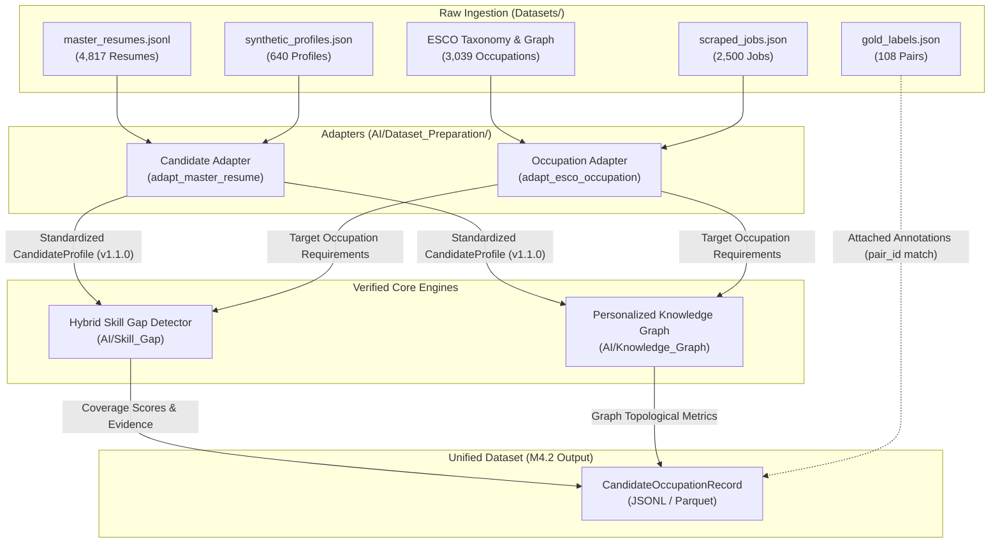

# Road2Hire — M4.2: Unified Candidate–Occupation Dataset Preparation

## 1. Objective & Scope

The objective of **M4.2** is to build the **Unified Candidate–Occupation Dataset** for Road2Hire.

This dataset pairs candidate profiles with target occupations to provide the foundational data structure for career readiness modeling, skill gap quantification, and personalized learning path recommendations.

### Key Principles & Constraints
1. **Zero Raw Data Modification**: Raw files in `Datasets/` are treated as immutable and accessed strictly in read-only mode.
2. **No Artificial Readiness Labels**: We do not synthesize artificial job-readiness labels or training targets without empirical ground-truth. Ground-truth scores from `gold_labels.json` are preserved only where verified annotations exist.
3. **No Algorithm Duplication**: All resume extraction, section detection, skill normalization, ESCO taxonomy lookup, hybrid gap detection, and personalized knowledge graph construction reuse existing, verified modules (`AI.Resume_Processing`, `AI.Skill_Extraction`, `AI.Skill_Gap`, `AI.Knowledge_Graph`).
4. **Explainable Features**: Skill gap coverage scores, match tiers, and topological metrics are explainable alignment measurements, never posterior probabilities.

---

## 2. Ingested Dataset Inventory

All raw datasets reside under the project root at `Datasets/`:

| Dataset Identifier | Relative Path | Format | Records | Size | Description |
|-------------------|---------------|--------|---------|------|-------------|
| `master_resumes` | `Datasets/master_resumes.jsonl` | JSON Lines | 4,817 | ~15.6 MB | Real resume records with structured personal info, experience, education, skills, projects, and certifications. |
| `scraped_jobs` | `Datasets/scraped_jobs.json` | JSON Array | 2,500 | ~9.5 MB | Scraped real-world job postings with titles, companies, locations, descriptions, and role family hints. |
| `synthetic_profiles` | `Datasets/synthetic_profiles.json` | JSON Array | 640 | ~418 KB | Controlled synthetic candidate profiles with target roles, primary/secondary skills, experience years, and seniority. |
| `gold_labels` | `Datasets/gold_labels.json` | JSON Array | 108 | ~37 KB | Verified human-annotated candidate-job pairs with skills, seniority, domain, location, and composite alignment scores. |
| `esco_skill_mapping` | `Datasets/ESCO_ONET/Mappings/ESCO_Skill_Mapping.csv` | CSV | ~126K | ~17.8 MB | Mappings between ESCO occupations, skills, categories, and importance (essential/optional). |
| `onet_skill_mapping` | `Datasets/ESCO_ONET/Mappings/ONET_Skill_Mapping.csv` | CSV | ~30K | ~3.7 MB | O*NET SOC codes, skills, skill types, importance scores, and level scores. |
| `esco_raw_taxonomy` | `Datasets/Skill_Taxonomy/Raw/ESCO/` | CSV Collection | 13,939 skills / 3,039 occupations | ~50 MB | Complete official ESCO v1.1 taxonomy CSVs (occupations, skills, hierarchies, relations). |

---

## 3. Schema Architecture

### A. Raw Source Schemas (`AI/Dataset_Preparation/source_schemas.py`)
- `MasterResumeRecord`: Captures `personal_info`, `experience`, `education`, `skills` (technical and languages), `projects`, and `certifications`.
- `ScrapedJobRecord`: Captures `id`, `title`, `company`, `location`, `description`, `seniority_level`, `employment_type`, `job_function`, `industry`, `url`, `role_family_hint`.
- `SyntheticProfileRecord`: Captures `profile_id`, `roles`, `skills_primary`, `skills_secondary`, `experience_years`, `seniority`, `domains`, `preferences`, `career_intent`.
- `GoldLabelRecord`: Captures `pair_id`, `skills`, `seniority`, `domain`, `location`, `composite`, `overqualified`, `reasoning`.

### B. Canonical Candidate Profile Schema (`AI/Candidate_Profile/profile_schema.py`)
All candidate sources are adapted into Road2Hire's standardized **CandidateProfile (schema v1.1.0)**:
```json
{
  "schema_version": "1.1.0",
  "source_file": "master_resumes:0",
  "candidate": {
    "name": "Jane Doe",
    "email": "jane@example.com",
    "phone": null,
    "location": "Pune, India",
    "summary": "Python Developer with experience in REST APIs and SQL"
  },
  "skills": [
    {"skill": "Python (computer programming)", "ESCO_Skill_Id": "http://data.europa.eu/esco/skill/4c5b2a62-5a76-4d99-a7a8-cbf04e9e8d1e", "ESCO_Skill_Name": "Python (computer programming)"}
  ],
  "education": [...],
  "experience": [...],
  "projects": [...],
  "certifications": [...],
  "metadata": {...}
}
```

### C. Unified Candidate–Occupation Pair Schema (`AI/Dataset_Preparation/unified_schema.py`)
Represents an evaluated candidate-occupation alignment record:
- `pair_id`: Unique deterministic identifier (`pair_{candidate_id}_{occupation_id}`).
- `candidate_id`: Source identifier.
- `candidate_source`: `"master_resumes"` | `"synthetic_profiles"` | `"resume_pdf"`.
- `candidate_profile`: Conforming `CandidateProfile` v1.1.0.
- `candidate_skills_normalized`: List of canonical skill strings.
- `target_occupation`: Breakdown of target role, essential requirements, and optional recommendations.
- `skill_gap_features`: Essential, optional, and overall coverage scores; matched, partial, missing, and surplus counts.
- `graph_features`: Topological metrics from the candidate's personalized knowledge graph.
- `matched_skills_evidence`: Detailed audit trail of match tiers, similarity scores, and explanations.
- `partially_matched_skills_evidence`: Taxonomic and semantic relatedness evidence.
- `missing_essential_skills`: List of missing essential requirements.
- `missing_optional_skills`: List of missing optional recommendations.
- `ground_truth`: Attached annotated scores from `gold_labels.json` when available.

---

## 4. Planned Processing Pipeline



### Pipeline Execution Steps:
1. **Streaming & Ingestion**: Read raw candidate records from `master_resumes.jsonl` using memory-safe streaming (`stream_master_resumes()`).
2. **Profile Standardization**: Convert raw JSON into `CandidateProfile` via `adapt_master_resume_to_candidate_profile()`. Skills are mapped to ESCO canonical concepts using `ESCOTaxonomy.find_skill()`.
3. **Target Pairing**: Pair each candidate profile with:
   - Verified target occupations from `gold_labels.json` where explicit pairs exist.
   - Domain-relevant ESCO occupations (e.g., Software Developer, Data Scientist, Systems Administrator).
4. **Skill Gap Extraction**: Execute `SkillGapDetector.detect_gap()` on each pair to extract exact, graph, and semantic match evidence and coverage scores.
5. **Personalized Graph Feature Extraction**: Execute `PersonalizedKnowledgeGraph` to extract topological metrics (total nodes, total edges, provenance links).
6. **Ground-Truth Attachment**: Match `pair_id` against `gold_labels.json` index to attach human ground truth scores without creating synthetic labels.
7. **Validation & Serialization**: Validate each pair against `CandidateOccupationRecord` schema and serialize to disk (`unified_candidate_occupation_dataset.jsonl`).

---

## 5. Usage Example

```python
from AI.Dataset_Preparation import (
    get_dataset_inventory,
    stream_master_resumes,
    adapt_master_resume_to_candidate_profile,
    adapt_esco_occupation,
)
from AI.Skill_Gap import get_skill_gap_detector

# 1. Scan available datasets
inventory = get_dataset_inventory()
print(f"Master resumes available: {inventory['master_resumes']['exists']}")

# 2. Stream a resume and adapt to CandidateProfile
raw_resume = next(stream_master_resumes(limit=1))
candidate_profile = adapt_master_resume_to_candidate_profile(raw_resume, candidate_id="0")

# 3. Adapt an ESCO occupation
occupation_summary = adapt_esco_occupation("software developer")

# 4. Compute hybrid skill gap features
detector = get_skill_gap_detector()
gap_report = detector.detect_gap(candidate_profile, "software developer")

print(f"Candidate: {candidate_profile['candidate']['name'] or 'Anonymous'}")
print(f"Target: {occupation_summary['occupation_title']}")
print(f"Overall Coverage: {gap_report['overall_skill_coverage_score']:.2%}")
```

---

## 6. Next Steps for Dataset Construction

1. **Construct Batch Generation Script**: Implement a batch processor to stream candidate resumes, execute skill gap detection across target occupations, and output unified JSONL records.
2. **Add Gold Pair Alignment**: Guarantee that all 108 pairs in `gold_labels.json` are fully resolved and included in the unified dataset with their human annotations.
3. **Partition Dataset**: Split unified pairs into stratified Train / Validation / Test sets based on candidate IDs (preventing candidate data leakage).

