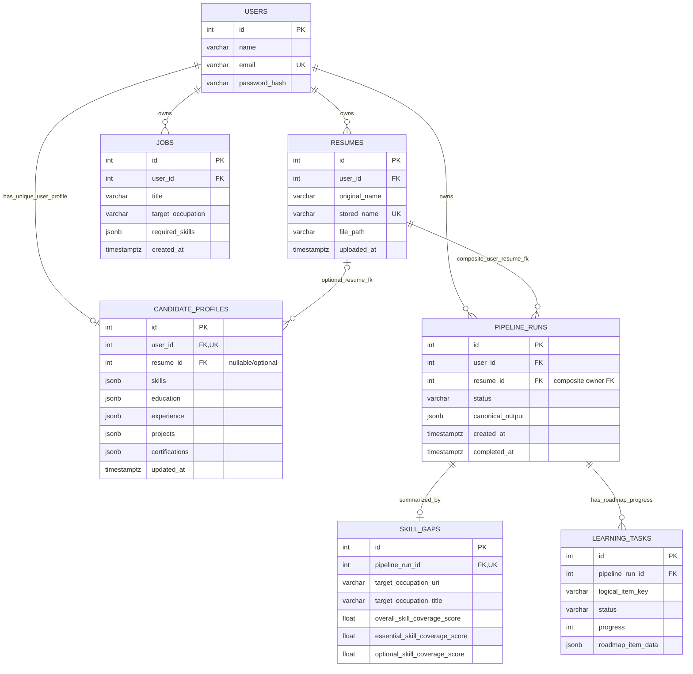

# Road2Hire entity-relationship diagram

The diagram shows the foreign-key cardinalities in the current database schema. `pipeline_runs` has both a user foreign key and an ownership-enforcing composite foreign key to `resumes`.

## Relationship and deletion details

- `candidate_profiles.user_id` is unique, so each user can have at most one profile. `candidate_profiles.resume_id` is nullable and uses `ON DELETE SET NULL`; it is not unique and is not constrained together with `user_id`. Therefore the database does not guarantee that the profile's resume belongs to its user, nor that a resume is referenced by at most one profile. The ORM's scalar `Resume.candidate_profile` relationship is stronger than the database constraint.
- `pipeline_runs.resume_id` is mandatory. The composite `(user_id, resume_id)` foreign key references `resumes(user_id, id)` and uses `ON DELETE RESTRICT`, preventing both cross-user resume association and deletion of a resume with run history. The separate `pipeline_runs.user_id` foreign key points to `users.id` with `ON DELETE CASCADE`.
- `skill_gaps.pipeline_run_id` is unique and cascades on run deletion, giving a run zero or one summary.
- `learning_tasks` belongs to a run and cascades on run deletion. Its `(pipeline_run_id, logical_item_key)` unique constraint prevents duplicate roadmap-item rows within a run.
- User deletion cascades to the user's resumes, pipeline runs, and jobs; candidate profiles are removed through the user foreign key. Resume deletion cascades to no pipeline run: it is restricted when run history references it.

For full column definitions and indexes, see [schema.sql](./schema.sql).
