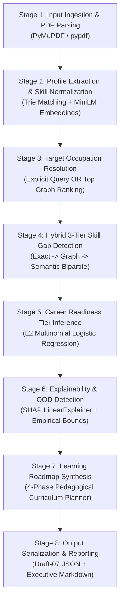

# Road2Hire — 01: AI/ML Architecture and Pipeline Specification

**Document Version:** 1.0.0  
**Pipeline Engine Version:** 3.0.0  
**Status:** Completed & Validated  
**Module:** AI/ML Core Orchestration  
**Primary Source Modules:** [`AI/Pipeline/pipeline.py`](file:///c:/Users/Sarvesh%20S.%20Kundale/Road2Hire/AI/Pipeline/pipeline.py), [`AI/road2hire_model.py`](file:///c:/Users/Sarvesh%20S.%20Kundale/Road2Hire/AI/road2hire_model.py), [`AI/Pipeline/cli.py`](file:///c:/Users/Sarvesh%20S.%20Kundale/Road2Hire/AI/Pipeline/cli.py)  

---

## 1. Executive Summary & Purpose

Road2Hire is an end-to-end career readiness and talent intelligence platform designed to evaluate candidate resumes against international occupational standards—specifically the European Skills, Competences, Qualifications and Occupations (**ESCO v1.1.1**) taxonomy and the US **O*NET** framework.

The platform extracts candidate competencies, maps them to canonical concept entities, determines exact and semantic skill gaps against target occupations, predicts multi-tier career readiness via regularized multinomial logistic regression, generates local game-theoretic explanations using SHAP, constructs candidate-specific knowledge graphs, and synthesizes 4-phase learning roadmaps.

This document describes the high-level architecture, module organization, central pipeline design, execution stages, and end-to-end data flow of the Road2Hire AI/ML Engine.

---

## 2. Overall Layered System Architecture

Road2Hire follows a modular, layered architecture that strictly decouples the client presentation, backend application services, database persistence, and AI/ML processing layers. Each layer communicates through versioned contracts and programmatic interfaces:

```
[User / Browser]
       │
       ▼
[Frontend Layer: Next.js / React / TypeScript / Tailwind CSS]
       │ (REST APIs / Multipart Upload / JSON)
       ▼
[Backend Application Layer: FastAPI / Python / Uvicorn]
  ├── Authentication & Session Management
  ├── Resume Ingestion & Storage Controller (Local Spool / Object Storage)
  ├── Asynchronous Task Broker (Celery / Redis / Background Workers)
  └── Database Persistence Layer (SQLAlchemy / PostgreSQL)
       │ (In-Process Python Interface / Worker Invocation)
       ▼
[AI/ML Engine Layer (Road2Hire Core)]
  ├── M1: Taxonomy & Knowledge Graph (ESCO v1.1.1, O*NET, NetworkX)
  ├── M2: Resume Intelligence & Extraction (PyMuPDF, Trie, MiniLM-L6-v2)
  ├── M3: Hybrid Skill Gap Detection & Personalized Knowledge Graph
  ├── M4: Career Readiness Classifier & OOD Detection (Logistic Regression)
  ├── M4.5: Explainability Engine (SHAP LinearExplainer)
  ├── Roadmap Engine: 4-Phase Pedagogical Curriculum Planner
  └── Reporting Engine: Canonical JSON Contract & Executive Markdown Reports
```

### System Architecture Diagram
A high-level visual representation of the system architecture is maintained in the documentation assets:  


### Architectural Layer Responsibilities

1. **Frontend Layer:**
   Provides an accessible user interface for candidates and career advisors. Facilitates drag-and-drop resume PDF uploads, target occupation selection, interactive skill visualization, 3-tier gap exploration, SHAP positive/negative impact waterfall graphs, and learning roadmap progress tracking.
2. **Backend Application Layer:**
   Coordinates application business logic. Validates uploaded PDF byte streams, provisions persistent storage paths, records candidate metadata, manages background worker queues, calls the AI/ML public Python interface, and maps structured results into relational and JSONB database tables.
3. **AI/ML Layer:**
   Executes heavy computational tasks: document text parsing, token-level Trie matching, dense vector embedding generation, bipartite graph matching, supervised readiness classification, Shapley value attribution, and curriculum synthesis.
4. **Database & Knowledge Graph Layer:**
   Maintains dual data stores:
   - **PostgreSQL Relational + JSONB Store:** Stores application state, user accounts, resume metadata, and historical analysis snapshots.
   - **In-Memory ESCO Knowledge Graph:** 17,618 nodes and 158,509 edges loaded once into resident memory and indexed via NetworkX for sub-millisecond taxonomic lookups.
5. **Explainability & Recommendation Layer:**
   Transforms black-box model inferences into transparent decision support: computes local feature attributions ($\phi_i$), verifies empirical bounding box distributions (OOD detection), and links missing essential competencies to curated pedagogical resources.

---

## 3. Component Organization & Directory Structure

The AI/ML implementation resides under the `AI/` package, organized into focused milestones:

```text
Road2Hire/
├── AI/
│   ├── Knowledge_Graph/                 # M1: ESCO/O*NET taxonomy loader & graph traversals
│   │   ├── esco_graph_manager.py        # Graph querying, hierarchy lookups, NetworkX indexing
│   │   └── esco_data_loader.py          # ESCO CSV parsing & relationship crosswalks
│   ├── Resume_Processing/               # M2: Resume text extraction & PDF decoding
│   │   ├── pdf_extractor.py             # PyMuPDF parser, whitespace normalizer, OCR flags
│   │   ├── section_detector.py          # Section boundary & heading regex pattern detector
│   │   └── resume_pipeline.py           # Combined extraction workflow
│   ├── Candidate_Profile/               # M2: Candidate profile builder & validator
│   │   ├── profile_schema.py            # CandidateProfile TypedDict schema v1.1.0
│   │   ├── profile_builder.py           # Centralized profile assembly factory method
│   │   ├── profile_validator.py         # Schema validator (fatal errors vs. warnings)
│   │   └── section_parsers.py           # Deterministic parsers for edu, exp, proj, certs
│   ├── Skill_Extraction/                # M2: Hybrid dictionary & semantic embedding matcher
│   │   ├── skill_extractor.py           # 99k-label Trie + all-MiniLM-L6-v2 vector embeddings
│   │   └── esco_taxonomy.py             # ESCO concepts & normalization lookups
│   ├── Skill_Gap/                       # M3: 3-tier gap detection engine
│   │   ├── skill_gap_detector.py        # Heuristic essential/optional skill gap analyzer
│   │   ├── gap_scoring.py               # Scoring formulas (0.75 Essential + 0.25 Optional)
│   │   └── gap_schema.py                # SkillGapReport data contract
│   ├── Knowledge_Graph/                 # M1/M3: ESCO taxonomy & candidate personalized graph
│   │   ├── esco_graph.py                # Graph querying, hierarchy lookups, NetworkX indexing
│   │   ├── personalized_graph.py        # Personalized NetworkX candidate knowledge subgraph
│   │   └── skill_graph_matcher.py       # Knowledge graph occupation-skill matching
│   ├── Readiness_Model/                 # M4/M4.5: Career Readiness & SHAP Explainability
│   │   ├── inference.py                 # Predictor, feature extractor, OOD detector
│   │   ├── model_trainer.py             # Model training, CV and serialization
│   │   ├── shap_explainer.py            # shap.LinearExplainer for feature log-odds attribution
│   │   └── saved_models/                # Model artifacts (.joblib, metadata, scalers)
│   ├── Pipeline/                        # Central Orchestrator & Public Interfaces
│   │   ├── __init__.py                  # Public exports (process_resume, get_pipeline)
│   │   ├── pipeline.py                  # Road2HirePipeline orchestrator class
│   │   ├── pipeline_schema.py           # UnifiedPipelineResult dataclass & to_canonical_dict()
│   │   ├── target_occupation_selector.py# Automatic & explicit target role resolution
│   │   ├── roadmap_generator.py         # 4-phase pedagogical curriculum builder
│   │   ├── report_generator.py          # Markdown executive summary generator
│   │   ├── cli.py                       # Standalone CLI entry point
│   │   └── schemas/                     # Formal Draft-07 JSON Schema contracts
│   │       ├── pipeline_output.schema.json
│   │       └── pipeline_error.schema.json
│   └── road2hire_model.py               # Centralized model pipeline & singleton accessors
├── Datasets/                            # Taxonomy, training data & learning resources
│   ├── ESCO_ONET/                       # ESCO v1.1.1 & O*NET taxonomy crosswalks
│   ├── Learning_Resources/              # Curated learning resources (courses, docs)
│   ├── Readiness_Dataset/               # Annotated training cohort (N=71)
│   └── Skill_Taxonomy/                  # Processed skill taxonomy lookups
└── Tests/AI/                            # Complete test suite (369 automated tests)
```

---

## 4. End-to-End Pipeline Execution Stages

When `Road2HirePipeline.run()` or `process_resume()` is called, the system executes an 8-stage sequence:



### Stage Breakdown

#### Stage 1 — Input Ingestion & PDF Text Extraction (M2)
- Validates input file existence, file extension (`.pdf`), and non-empty byte streams ($> 0\text{ bytes}$).
- Extracts page-level text, character counts, and document metadata using PyMuPDF.
- Normalizes carriage returns, cleans extraneous whitespace, and strips null characters without altering technical terminology.
- Flags documents containing no extractable text with `extraction_status: "needs_ocr"` or raises `ResumeValidationError` (`RESUME_PARSE_FAILED`).

#### Stage 2 — Section Detection & Candidate Profile Assembly (M2)
- Detects major resume sections using case-insensitive heading pattern recognition: Contact Information, Summary, Education, Experience, Skills, Projects, and Certifications.
- Extracts contact details (name, email, phone, location) from header lines preceding the first section.
- Executes deterministic parsers (`AI/Candidate_Profile/section_parsers.py`) to extract structured education degrees, dates, institutions, GPA/percentage, experience bullet points, and project technologies.
- Extracts candidate skills via an Aho-Corasick boundary-aware Trie covering 99,676 ESCO preferred and alternative labels.
- Normalizes matched skills to canonical ESCO URIs and generates 384-dimensional dense semantic vectors using `sentence-transformers/all-MiniLM-L6-v2`.
- Validates assembled candidate profile against Schema Version `1.1.0`.

#### Stage 3 — Target Occupation Resolution (M1 / M2)
- **Explicit Mode:** Resolves user-provided string or concept URI against the ESCO taxonomy using `ESCOKnowledgeGraph.resolve_occupation_uri()`. Supports fuzzy title matching and canonical URI lookup.
- **Automatic Ranking Mode (`allow_auto_select=True`):** If `target_occupation=None`, evaluates candidate skills against all 2,942 ESCO occupations. Computes Jaccard overlap and taxonomy graph connection counts, selecting the highest-scoring occupation.
- *Strict Guardrail:* If `target_occupation=None` and `allow_auto_select=False` (default), the pipeline raises `OccupationSelectionError` (`OCCUPATION_SELECTION_REQUIRED`), returning top recommendations for user selection.

#### Stage 4 — Hybrid 3-Tier Skill Gap Detection (M3)
- Fetches canonical skill requirements for the target occupation, partitioned into:
  - Essential skills ($N_E$)
  - Optional skills ($N_O$)
- Executes three-tier matching with strict 1-to-1 candidate-to-target assignment:
  - **Tier 1 (Exact/Normalized):** URI match or normalized label match (Credit = 1.0).
  - **Tier 2 (Taxonomy Relations):** NetworkX traversal (`is_narrower_than` = 0.75, `is_related_to` = 0.70, `is_broader_than` = 0.60).
  - **Tier 3 (Semantic Similarity):** Maximum-weight bipartite matching (Hungarian algorithm) over 384-d MiniLM embeddings with hard-negative guardrails (Credit = 1.0 if $\ge 0.82$, $0.5 \times \text{sim}$ if $0.65 \le \text{sim} < 0.82$, 0.0 otherwise).
- Emits categorized sets: `matched_skills`, `partially_matched_skills`, `missing_essential_skills`, `missing_optional_skills`, and `surplus_candidate_skills`.
- Computes weighted overall coverage: $S_{\text{overall}} = 0.75 \times S_E + 0.25 \times S_O$.

#### Stage 5 — Career Readiness Tier Inference (M4)
- Extracts a 5-dimensional normalized profile feature vector:
  1. `skill_overlap_ratio`: Jaccard skill overlap with target occupation.
  2. `years_experience`: Normalized total work experience years.
  3. `education_level_numeric`: Ordinal academic attainment (Secondary=1, Bachelor=2, Master=3, PhD=4).
  4. `essential_skill_coverage`: Proportion of essential skills matched ($S_E$).
  5. `optional_skill_coverage`: Proportion of optional skills matched ($S_O$).
- Executes L2-regularized multinomial logistic regression pipeline (`StandardScaler` + `LogisticRegression`).
- Predicts readiness class (`Developing`, `Job Ready`, `Not Ready`) and outputs Softmax probability distribution.

#### Stage 6 — Explainability & OOD Detection (M4.5)
- Computes game-theoretic local feature attributions ($\phi_i$) using `shap.LinearExplainer` on the predicted class margin, satisfying the Efficiency Axiom:
  $$\text{base\_value}_c + \sum_{i=1}^{D} \phi_{i, c} = f_c(x)$$
- Identifies top positive drivers and top negative constraints shifting the candidate toward or away from readiness.
- Evaluates feature vector against empirical bounding boxes ($N=71$ training distribution). Flags anomalies (`is_ood: true`) with descriptive warnings if any feature falls outside training limits.

#### Stage 7 — Personalized Learning Roadmap Synthesis
- Transforms missing essential and optional skills into a sequential 4-phase pedagogical curriculum:
  - **Phase 1 (Foundations):** Missing essential knowledge concepts and theoretical prerequisites (2–4 weeks).
  - **Phase 2 (Core Competencies):** Core technical implementation skills and mandatory frameworks (4–8 weeks).
  - **Phase 3 (Applied Systems):** Deepening partially matched skills through hands-on project execution (4–6 weeks).
  - **Phase 4 (Specialization):** Advanced optional capabilities, cloud platforms, and architecture (2–4 weeks).
- Enriches each roadmap milestone with practical project scenarios, verifiable completion criteria, and curated resources from `Datasets/Learning_Resources/`.

#### Stage 8 — Serialization, Verification & Reporting
- Encapsulates all results into an immutable `UnifiedPipelineResult` dataclass.
- Formulates Draft-07 JSON dictionary conforming to `pipeline_output.schema.json`.
- Renders an executive Markdown summary report.
- Saves artifacts into timestamped output folders (`Outputs/`) when file generation is enabled.

---

## 5. Thread Safety, Singleton Access & Pre-Warming

The AI/ML engine loads heavy assets into memory:
- ESCO taxonomy graph: 17,618 nodes, 158,509 edges ($\approx 85\text{ MB}$).
- SentenceTransformer `all-MiniLM-L6-v2` embedding model ($\approx 420\text{ MB}$).
- Scikit-learn readiness pipeline and SHAP explainer ($\approx 35\text{ MB}$).

### Reentrant Locking (`threading.RLock`)
To enable concurrent inference requests within multi-threaded server environments (e.g. FastAPI / Uvicorn worker threads):
- `Road2HirePipeline` and underlying model accessors (`get_pipeline()`, `get_road2hire_model()`) are protected by `threading.RLock`.
- Thread locks prevent race conditions during lazy initialization while allowing reentrant calls across nested internal methods without deadlock.

### Startup Pre-Warming
Cold-start initialization requires $\approx 14\text{s}$ to $18\text{s}$. Once loaded into resident RAM, subsequent inferences execute in $1.8\text{s}$ to $2.5\text{s}$. Backend services must pre-warm singletons during application startup:

```python
from AI.Pipeline import get_pipeline

# FastAPI lifespan pre-warming
pipeline = get_pipeline()
pipeline._ensure_graph()
pipeline._ensure_skill_extractor()
pipeline._ensure_readiness_model()
```

---

## 6. Execution Modes (CLI & Programmatic)

### Programmatic Python Interface
Designed for direct backend web service and Celery worker integration:

```python
from AI.Pipeline import process_resume

# Functional invocation returning canonical JSON-serializable dictionary
result = process_resume(
    resume_path="Tests/AI/sample_resume.pdf",
    target_occupation="Data Engineer",
    output_format="none",  # Suppresses disk I/O for API efficiency
    allow_auto_select=False,
)

if result["status"] == "success":
    data = result["data"]
    print("Candidate:", data["candidate_profile"]["name"])
    print("Readiness Tier:", data["career_readiness"]["predicted_class"])
    print("Match Score:", data["skill_gap_analysis"]["match_score"])
```

### Standalone Command-Line Interface (CLI)
Designed for batch evaluations, testing, and administration:

```bash
# Explicit target occupation
python -m AI.Pipeline.cli Tests/AI/sample_resume.pdf --occupation "data engineer"

# Interactive occupation selection prompt
python -m AI.Pipeline.cli Tests/AI/sample_resume.pdf --interactive

# Custom output format and directory
python -m AI.Pipeline.cli Tests/AI/sample_resume.pdf --occupation "software developer" --output-dir "Outputs" --format both
```

---

## 7. Related Documentation

- For research motivation, literature review, and taxonomy strategy, see [02: Research & Taxonomy](file:///c:/Users/Sarvesh%20S.%20Kundale/Road2Hire/Docs/02_AI_ML_Research_and_Taxonomy.md).
- For algorithmic formulas, matching tiers, and SHAP math, see [03: Algorithms & Methodology](file:///c:/Users/Sarvesh%20S.%20Kundale/Road2Hire/Docs/03_AI_ML_Algorithms_and_Methodology.md).
- For empirical validation, benchmarks, and known limitations, see [04: Model Evaluation & Limitations](file:///c:/Users/Sarvesh%20S.%20Kundale/Road2Hire/Docs/04_AI_ML_Model_Evaluation_and_Limitations.md).
- For public APIs, JSON Schemas, and error handling, see [05: Output & Integration Contract](file:///c:/Users/Sarvesh%20S.%20Kundale/Road2Hire/Docs/05_AI_ML_Output_and_Integration_Contract.md).
- For database architecture and PostgreSQL mappings, see [06: Database Storage Specification](file:///c:/Users/Sarvesh%20S.%20Kundale/Road2Hire/Docs/06_AI_ML_Database_Storage_Specification.md).
- For engineering handover and checklists, see [07: Final Handover Document](file:///c:/Users/Sarvesh%20S.%20Kundale/Road2Hire/Docs/07_AI_ML_Final_Handover.md).
