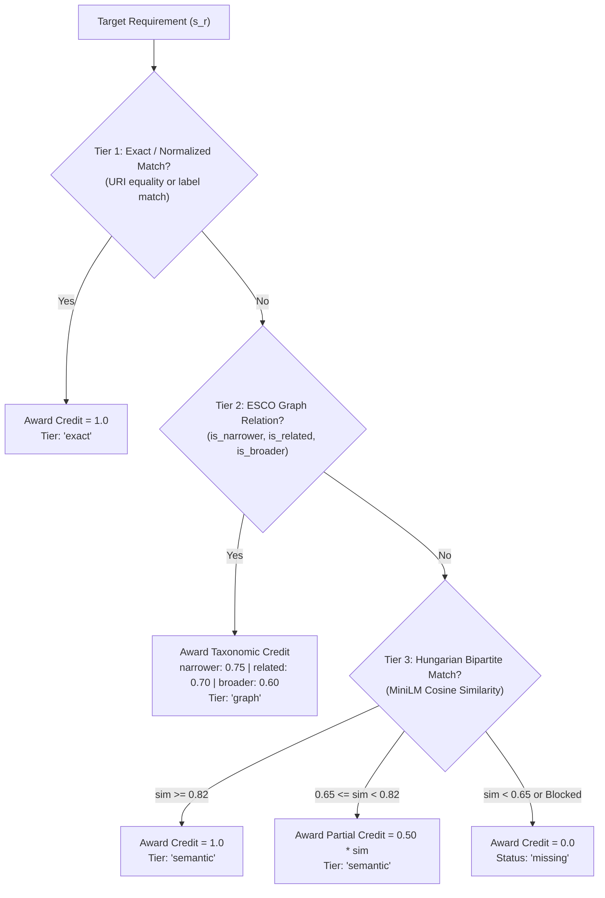
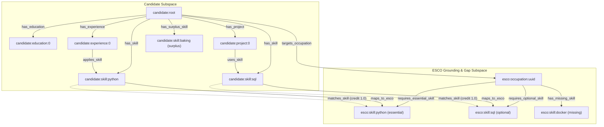

# Road2Hire — 03: AI/ML Algorithms, Mathematical Formulations and Methodology

**Document Version:** 1.0.0  
**Pipeline Engine Version:** 3.0.0  
**Status:** Completed & Validated  
**Module:** AI/ML Algorithmic Implementations (M1 – M4.5)  
**Primary Source Modules:** [`AI/Resume_Processing/`](file:///c:/Users/Sarvesh%20S.%20Kundale/Road2Hire/AI/Resume_Processing), [`AI/Candidate_Profile/`](file:///c:/Users/Sarvesh%20S.%20Kundale/Road2Hire/AI/Candidate_Profile), [`AI/Skill_Extraction/`](file:///c:/Users/Sarvesh%20S.%20Kundale/Road2Hire/AI/Skill_Extraction), [`AI/Skill_Gap/`](file:///c:/Users/Sarvesh%20S.%20Kundale/Road2Hire/AI/Skill_Gap), [`AI/Knowledge_Graph/`](file:///c:/Users/Sarvesh%20S.%20Kundale/Road2Hire/AI/Knowledge_Graph), [`AI/Readiness_Model/`](file:///c:/Users/Sarvesh%20S.%20Kundale/Road2Hire/AI/Readiness_Model)  

---

## 1. Algorithmic Overview

The Road2Hire AI/ML module implements a deterministic, multi-stage processing pipeline that converts unstructured text into granular candidate knowledge representations, mathematically evaluates alignment with standardized occupations, predicts career readiness tiers, and calculates exact game-theoretic feature attributions:

```
[Resume PDF]
     │
     ▼
[Stage 1: Document Parsing & Text Cleaning]
     │  (PyMuPDF, Stream Extraction, Line Break Normalization)
     ▼
[Stage 2: Section Detection & Deterministic Entity Parsing]
     │  (Regex Headings, CandidateProfile Schema v1.1.0 Assembly)
     ▼
[Stage 3: Hybrid Skill Extraction & Semantic Vectorization]
     │  (99,676-node Trie, ESCO Normalization, all-MiniLM-L6-v2 Embeddings)
     ▼
[Stage 4: 3-Tier Hybrid Skill Gap Detection]
     │  (Tier 1 Exact -> Tier 2 Graph -> Tier 3 Hungarian Bipartite Matching)
     ▼
[Stage 5: Personalized Candidate Knowledge Subgraph Construction]
     │  (Contextual NetworkX DiGraph, Provenance & Taxonomy Edges)
     ▼
[Stage 6: Supervised Career Readiness Classification & OOD Detection]
     │  (L2 Multinomial Logistic Regression, Empirical Bounding Box Check)
     ▼
[Stage 7: Axiomatic Game-Theoretic Explainability (SHAP)]
     │  (shap.LinearExplainer, Efficiency Axiom Additivity)
     ▼
[Stage 8: 4-Phase Pedagogical Curriculum Synthesis]
        (Prioritized Milestones, Learning Resources, Project Scenarios)
```

---

## 2. Resume Ingestion, Text Cleaning & Section Detection (M2)

### 2.1 PDF Stream Extraction
Document ingestion in `AI/Resume_Processing/pdf_extractor.py` utilizes PyMuPDF (`fitz`) to read text streams page by page:
- **Encoding Normalization:** Strips null bytes (`\x00`), handles Windows (`\r\n`) and legacy Mac (`\r`) line breaks, and reduces multiple whitespaces.
- **Structural Preservation:** Preserves semantic line breaks and double line breaks for paragraph separation to prevent collapsing bulleted lists into continuous text blocks.
- **Fallback & OCR Status:** If character count across all pages is $< 50$, the document is flagged with status `needs_ocr`, preventing downstream parsing crashes on scanned image resumes.

### 2.2 Section Detection
Detects major structural resume sections using normalized heading aliases:
- `summary`: "Professional Summary", "Executive Summary", "Summary", "About Me", "Objective"
- `education`: "Education", "Academic Background", "Qualifications", "Degrees"
- `experience`: "Work Experience", "Professional Experience", "Employment History", "Experience", "Internships"
- `skills`: "Technical Skills", "Skills & Competencies", "Core Skills", "Technologies", "Skills"
- `projects`: "Technical Projects", "Key Projects", "Academic Projects", "Projects"
- `certifications`: "Certifications", "Licenses", "Professional Credentials", "Certificates"

### 2.3 Granular Record Parsers (`AI/Candidate_Profile/section_parsers.py`)
To avoid treating sections as monolithic text blobs, deterministic rule-based parsers extract typed sub-records:
1. **Contact Information (`CandidateInfo`):** Evaluates lines preceding the first section header. Extracts email via RFC 5322 regex, phone numbers via international dial patterns, and location via recognized city/state tokens.
2. **Education (`EducationRecord`):** Extracts degree, major discipline, institution name, start/end years, and validates academic score bounds ($0.0 \le \text{CGPA} \le 10.0$ and $0.0 \le \text{Percentage} \le 100.0$).
3. **Experience (`ExperienceRecord`):** Identifies job title, organization name, employment type (`internship`, `full-time`), date ranges, bulleted responsibilities, and associates extracted skills used.
4. **Projects (`ProjectRecord`):** Identifies project titles, narrative descriptions, referenced technologies, and contribution bullets.
5. **Certifications (`CertificationRecord`):** Extracts credential title, issuing organization, issue/expiration dates, and credential license IDs.

---

## 3. Skill Extraction, ESCO Normalization & Semantic Embeddings (M2)

### 3.1 Boundary-Aware Trie Tokenization
Skill extraction is executed by an Aho-Corasick automaton indexed over **99,676 preferred and alternative labels** from ESCO v1.1.1:
- Matches whole-word boundaries in $O(L)$ time, where $L$ is resume document length.
- Case-folding and punctuation normalization prevent false mismatches.
- Resolves abbreviations and acronyms to canonical concept URIs via alias tables (`Datasets/Skill_Taxonomy/`).

### 3.2 Dense Semantic Embeddings
Every normalized skill and missing requirement is mapped into a continuous 384-dimensional vector space using:
- **Model:** `sentence-transformers/all-MiniLM-L6-v2`
- **Embedding Dimension:** $D = 384$
- **Inference Normalization:** L2-normalized ($\|\mathbf{v}\|_2 = 1.0$), ensuring that dot products equal cosine similarities:
  $$\text{sim}(\mathbf{u}, \mathbf{v}) = \mathbf{u} \cdot \mathbf{v} = \sum_{i=1}^{384} u_i v_i$$

---

## 4. Hybrid 3-Tier Skill Gap Detection (M3)

Skill gap analysis compares candidate skills ($C$) against target occupation requirements ($R = E \cup O$) through a hierarchical three-tier matching engine with strict **one-to-one assignment**:



### 4.1 Tier 1: Exact & Normalized Concept Mapping (Credit = 1.0)
- Identifies identical concepts where candidate concept URI equals the required concept URI:
  $$\text{URI}(c) = \text{URI}(r) \implies c(r) = 1.0$$
- If unmapped by URI, evaluates normalized preferred and alternative labels in the ESCO taxonomy.

### 4.2 Tier 2: ESCO Knowledge Graph Taxonomic Relations
Evaluates remaining candidate skills with valid ESCO URIs against remaining target skills via NetworkX graph traversal:
- **`is_narrower_than` (Credit = 0.75):** The candidate possesses a more specialized skill than required (e.g. "React" when "frontend framework" is requested).
- **`is_related_to` (Credit = 0.70):** The candidate has a conceptually related skill directly connected by an ESCO associative edge.
- **`is_broader_than` (Credit = 0.60):** The candidate possesses broader domain knowledge encompassing the requirement.

### 4.3 Tier 3: Semantic Similarity Matching via Hungarian Bipartite Assignment
Unmatched candidate skills and target skills are evaluated in semantic vector space:
1. **Hard-Negative Guardrails (`KNOWN_DISTINCT_PAIRS`):** Blocks semantically proximate but distinct technical entities:
   - `Java` $\leftrightarrow$ `JavaScript` ($\text{sim} \leftarrow 0.0$)
   - `C` $\leftrightarrow$ `C++` $\leftrightarrow$ `C#` ($\text{sim} \leftarrow 0.0$)
   - `Rust` $\leftrightarrow$ `Go` ($\text{sim} \leftarrow 0.0$)
2. **Global Optimal Assignment:** Solves the maximum-weight bipartite matching problem via the Hungarian algorithm (`scipy.optimize.linear_sum_assignment`), finding the permutation $\pi$ that maximizes:
   $$\max_{\pi} \sum_{i} \text{sim}(c_i, r_{\pi(i)})$$
   avoiding greedy sequential bias.
3. **Calibrated Thresholds:**
   - $\text{sim} \ge 0.82$: Confirmed semantic match (Credit = $1.0$).
   - $0.65 \le \text{sim} < 0.82$: Partial match (Credit = $0.50 \times \text{sim}$).
   - $\text{sim} < 0.65$: Non-match (Credit = $0.0$; skill remains missing).

### 4.4 Mathematical Coverage Formulation
Let $E$ be the set of essential skills ($N_E = |E|$) and $O$ be the set of optional skills ($N_O = |O|$):

- **Essential Skill Coverage ($S_E$):**
  $$S_E = \begin{cases} \frac{1}{N_E} \sum_{s \in E} c(s) & \text{if } N_E > 0 \\ 1.0 & \text{if } N_E = 0 \end{cases}$$

- **Optional Skill Coverage ($S_O$):**
  $$S_O = \begin{cases} \frac{1}{N_O} \sum_{s \in O} c(s) & \text{if } N_O > 0 \\ \text{null} & \text{if } N_O = 0 \end{cases}$$

- **Overall Skill Coverage ($S_{\text{overall}}$):**
  $$S_{\text{overall}} = \begin{cases} S_E & \text{if } N_O = 0 \text{ or } S_O \text{ is null} \\ 0.75 \cdot S_E + 0.25 \cdot S_O & \text{otherwise} \end{cases}$$

### 4.5 Edge-Case Invariants
- **Freshers / Zero Skills:** Coverage scores evaluate strictly to $0.0$; all requirements are partitioned into `missing_essential_skills` and `missing_optional_skills`.
- **Occupations with Zero Optional Skills:** $S_O = \text{null}$, and $S_{\text{overall}} = S_E$, preventing artificial penalties or division-by-zero errors.

---

## 5. Personalized Candidate Knowledge Graph (M3)

Rather than copying the global 17,618-node ESCO graph, the personalized graph engine (`AI/Knowledge_Graph/personalized_graph.py`) dynamically instantiates a compact directed graph (`nx.DiGraph`):



### 5.1 Node Taxonomy (8 Distinct Kinds)
1. `candidate`: Root candidate entity (`candidate:root`).
2. `education`: Academic degrees (`candidate:education:{idx}`).
3. `experience`: Professional employment records (`candidate:experience:{idx}`).
4. `project`: Project implementations (`candidate:project:{idx}`).
5. `certification`: Formal credentials (`candidate:certification:{idx}`).
6. `candidate_skill`: Skills extracted from resume (`candidate:skill:{norm_name}`).
7. `esco_skill`: Canonical ESCO concept (`http://data.europa.eu/esco/skill/{uuid}`).
8. `occupation`: Target occupational role (`http://data.europa.eu/esco/occupation/{uuid}`).

### 5.2 Edge Taxonomy (15 Canonical Relationships)
- **Profile Composition:** `has_education`, `has_experience`, `has_project`, `has_certification`, `has_skill`.
- **Provenance & Evidence:** `applies_skill` (experience $\to$ skill), `uses_skill` (project $\to$ skill).
- **Taxonomic Grounding:** `maps_to_esco` (candidate skill $\to$ ESCO URI).
- **Occupational Requirements:** `requires_essential_skill`, `requires_optional_skill`, `has_missing_skill`.
- **Skill Alignment:** `matches_skill` (credit 1.0), `partially_matches_skill` (taxonomic/semantic credit), `has_surplus_skill`.
- **Taxonomy Hierarchy:** `broader_skill`, `narrower_skill`, `related`.

---

## 6. Supervised Career Readiness Prediction (M4)

### 6.1 Formulation & Target Variable
Career readiness prediction models whether a candidate possesses the background and execution maturity to succeed in a target role. The target variable is defined over three mutually exclusive classes:
$$y \in \{\text{Not Ready}, \text{Developing}, \text{Job Ready}\}$$

### 6.2 Profile Feature Space ($\mathbf{x} \in \mathbb{R}^9$)
Features are deterministically extracted from candidate profiles without data leakage:
1. `skills_count`: Total count of canonical skills extracted from resume ($x_1$).
2. `exp_positions_count`: Number of distinct professional work positions ($x_2$).
3. `has_senior_role`: Binary indicator for senior, lead, architect, or manager titles ($x_3$).
4. `project_count`: Total number of documented technical projects ($x_4$).
5. `project_words`: Cumulative narrative token count across project descriptions ($x_5$).
6. `project_tech_count`: Count of distinct technologies specified within projects ($x_6$).
7. `has_production_system`: Binary indicator for production/deployment keywords ($x_7$).
8. `edu_level_ordinal`: Highest educational attainment ($1 = \text{Secondary/Diploma}$, $2 = \text{Bachelor}$, $3 = \text{Master/PhD}$) ($x_8$).
9. `is_stem_degree`: Binary flag indicating Computer Science, IT, or Engineering degrees ($x_9$).

### 6.3 Mathematical Model & Inference
The classifier is an L2-regularized multinomial logistic regression pipeline (`StandardScaler` + `LogisticRegression`):
- Features are standardized to zero mean and unit variance:
  $$z_i = \frac{x_i - \mu_i}{\sigma_i}$$
- Linear decision functions for each class $c \in \{0, 1, 2\}$:
  $$f_c(\mathbf{z}) = \mathbf{w}_c^T \mathbf{z} + b_c$$
- Predicted readiness class:
  $$\hat{y} = \arg\max_{c} f_c(\mathbf{z})$$
- Uncalibrated Softmax probabilities:
  $$P(Y = c \mid \mathbf{z}) = \frac{\exp(f_c(\mathbf{z}))}{\sum_{k} \exp(f_k(\mathbf{z}))}$$

---

## 7. Out-of-Distribution (OOD) Detection

### 7.1 Empirical Bounding Box Architecture
Because the M4 model was trained on an annotated cohort of $N = 71$ candidates, extreme resume features cause the linear model to extrapolate. The `ReadinessOODDetector` tracks univariate empirical training bounds:

| Feature Name | Training Min | Training Max | Training Mean | Training Std | Warning Threshold |
| :--- | :---: | :---: | :---: | :---: | :--- |
| `skills_count` | 0.0 | 14.0 | 6.94 | 3.32 | $< 0$ or $> 14.0$ ($|z| > 3.0$) |
| `exp_positions_count` | 0.0 | 4.0 | 1.34 | 1.08 | $< 0$ or $> 4.0$ ($|z| > 3.0$) |
| `has_senior_role` | 0.0 | 1.0 | 0.17 | 0.38 | Binary |
| `project_count` | 0.0 | 5.0 | 2.37 | 1.09 | $< 0$ or $> 5.0$ ($|z| > 3.0$) |
| `project_words` | 0.0 | 258.0 | 94.32 | 48.74 | $< 0$ or $> 258.0$ ($|z| > 3.0$) |
| `project_tech_count` | 0.0 | 16.0 | 5.66 | 3.44 | $< 0$ or $> 16.0$ ($|z| > 3.0$) |
| `has_production_system`| 0.0 | 1.0 | 0.44 | 0.50 | Binary |
| `edu_level_ordinal` | 1.0 | 2.0 | 1.25 | 0.44 | $< 1.0$ or $> 2.0$ |
| `is_stem_degree` | 0.0 | 1.0 | 0.86 | 0.35 | Binary |

### 7.2 Non-Blocking Transparency Safeguard
When feature values exceed empirical limits:
- The detector sets `is_ood: true` and appends detailed warning strings to `ood_warnings`.
- Inference continues gracefully without aborting or clipping feature values.
- Downstream systems and Markdown reports display advisory alerts warning that the model is extrapolating.

---

## 8. Axiomatic Explainability via SHAP (M4.5)

Explainability in `AI/Readiness_Model/shap_explainer.py` uses `shap.LinearExplainer` to provide mathematically exact local feature attribution:

### 8.1 Efficiency Axiom Satisfaction
For linear models in scaled feature space, the game-theoretic Shapley value $\phi_{i, c}$ for feature $i$ and class $c$ satisfies the Efficiency Axiom to machine precision ($\le 10^{-15}$):
$$\text{base\_value}_c + \sum_{i=1}^{9} \phi_{i, c} = f_c(\mathbf{z})$$
where $\phi_{i, c} = w_{c, i} \cdot (z_i - \mathbb{E}[z_i]) = w_{c, i} \cdot z_i$ (since features are standardized).

### 8.2 Global Feature Ranking
Mean absolute SHAP importance ($\frac{1}{N \cdot C} \sum_{n, c} |\phi_{n, i, c}|$) across the training distribution:

| Rank | Feature | Mean \|SHAP\| | Interpretation |
| :---: | :--- | :---: | :--- |
| **1** | `skills_count` | **0.9038** | Primary driver: canonical skill breadth |
| **2** | `edu_level_ordinal` | **0.6041** | Highest academic degree attainment |
| **3** | `exp_positions_count` | **0.3145** | Documented employment tenure and positions |
| **4** | `is_stem_degree` | **0.2568** | Degree alignment with computer science/engineering |
| **5** | `has_senior_role` | **0.2205** | Senior, lead, or architect title designation |
| **6** | `project_tech_count` | **0.1861** | Distinct technologies used in projects |
| **7** | `project_words` | **0.1608** | Narrative technical depth of project descriptions |
| **8** | `has_production_system`| **0.1201** | Production deployment and enterprise scope |
| **9** | `project_count` | **0.0890** | Total documented projects |

---

## 9. 4-Phase Learning Roadmap Synthesis

The roadmap synthesizer (`AI/Pipeline/roadmap_generator.py`) maps missing skills from M3 into four progressive pedagogical milestones:

| Phase | Pedagogical Focus | Target Skill Set | Typical Duration |
| :---: | :--- | :--- | :---: |
| **Phase 1** | **Foundational Competencies & Core Concepts** | Missing essential knowledge concepts (`skill_type == 'knowledge'`) and theoretical prerequisites | 2 – 4 Weeks |
| **Phase 2** | **Core Technical Implementation Skills** | Remaining missing essential technical tools and frameworks (`skill_type == 'skill/competence'`) | 4 – 8 Weeks |
| **Phase 3** | **Applied Systems & Portfolio Project Execution** | Partially matched skills to deepen from theoretical familiarity to hands-on production capability | 4 – 6 Weeks |
| **Phase 4** | **Advanced Specialization & Optional Capabilities** | Missing optional skills, advanced cloud architecture, and enterprise tooling | 2 – 4 Weeks |

Each milestone provides concrete learning activities, realistic portfolio project scenarios, verifiable completion criteria, and curated course links from `Datasets/Learning_Resources/`.

---

## 10. Related Documentation

- For overall architecture and pipeline stages, see [01: Architecture & Pipeline](file:///c:/Users/Sarvesh%20S.%20Kundale/Road2Hire/Docs/01_AI_ML_Architecture_and_Pipeline.md).
- For research questions, literature review, and taxonomy design, see [02: Research & Taxonomy](file:///c:/Users/Sarvesh%20S.%20Kundale/Road2Hire/Docs/02_AI_ML_Research_and_Taxonomy.md).
- For empirical evaluation, cross-validation metrics, and known limitations, see [04: Model Evaluation & Limitations](file:///c:/Users/Sarvesh%20S.%20Kundale/Road2Hire/Docs/04_AI_ML_Model_Evaluation_and_Limitations.md).
- For JSON contracts, schemas, and public API interfaces, see [05: Output & Integration Contract](file:///c:/Users/Sarvesh%20S.%20Kundale/Road2Hire/Docs/05_AI_ML_Output_and_Integration_Contract.md).
- For database architecture and PostgreSQL mappings, see [06: Database Storage Specification](file:///c:/Users/Sarvesh%20S.%20Kundale/Road2Hire/Docs/06_AI_ML_Database_Storage_Specification.md).
- For engineering handover and checklists, see [07: Final Handover Document](file:///c:/Users/Sarvesh%20S.%20Kundale/Road2Hire/Docs/07_AI_ML_Final_Handover.md).
