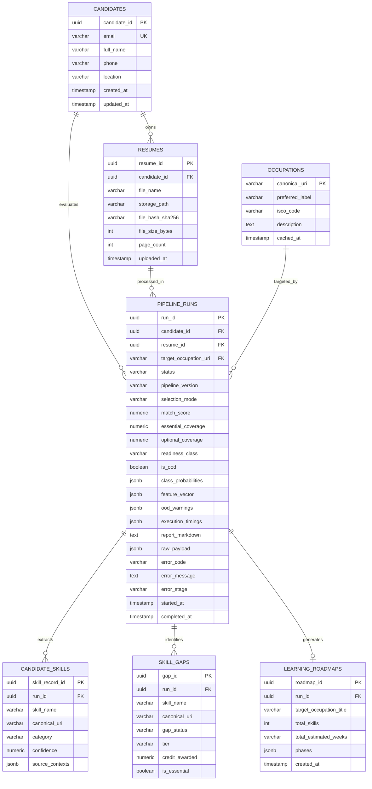

# Road2Hire — 06: Database Storage Specification and AI/ML Data Mapping

**Document Version:** 1.0.0  
**Specification Version:** 1.0.0  
**Pipeline Engine Version:** 3.0.0  
**Status:** Completed & Validated  
**Module:** Backend Database Architecture & AI/ML Data Mapping  
**Target Engine:** PostgreSQL 14+ (Relational + JSONB)  

---

## 1. Architectural Justification: Hybrid Persistence Model

The Road2Hire AI/ML pipeline emits complex, multi-layered career readiness analyses containing both relational entities (candidate IDs, resume paths, run execution status, scalar match scores) and deeply nested structures (education chronologies, 4-phase learning milestones, local SHAP attribution arrays, knowledge subgraphs).

To optimize query performance, analytical reporting, and schema evolution, Road2Hire specifies a **Hybrid Relational + Document (PostgreSQL JSONB)** persistence architecture:

1. **Relational Columns (3NF):** High-frequency filter keys, foreign key relationships, candidate IDs, execution run states, and aggregate scores (`match_score`, `predicted_class`) are stored in strongly typed relational columns to support $B$-Tree indexing and relational dashboards.
2. **PostgreSQL `JSONB` Columns:** Granular nested data (`candidate_profile`, `explainability`, `knowledge_graph`, `learning_roadmap`, raw execution payloads) are stored in binary JSON (`JSONB`), avoiding multi-table joins while enabling GIN indexing over internal JSON keys.

---

## 2. Entity-Relationship Diagram (ERD)

The specification defines seven core entities in a relational schema:



---

## 3. Entity Definitions & Table Specifications

### 3.1 `candidates`
Stores candidate identity and contact information.
- `candidate_id` (`UUID`, Primary Key): Unique candidate identifier.
- `email` (`VARCHAR(255)`, Unique, Nullable): Validated email address.
- `full_name` (`VARCHAR(255)`, Nullable): Candidate full name.
- `phone` (`VARCHAR(50)`, Nullable): Contact phone number.
- `location` (`VARCHAR(255)`, Nullable): City, state, or country.
- `created_at` (`TIMESTAMPTZ`): Record creation timestamp.
- `updated_at` (`TIMESTAMPTZ`): Last profile update.

### 3.2 `resumes`
Maintains uploaded PDF file metadata and object storage references.
- `resume_id` (`UUID`, Primary Key): Unique resume document ID.
- `candidate_id` (`UUID`, Foreign Key $\to$ `candidates.candidate_id` ON DELETE CASCADE).
- `file_name` (`VARCHAR(255)`): Original uploaded filename.
- `storage_path` (`VARCHAR(1024)`): S3 URI or local filesystem path.
- `file_hash_sha256` (`CHAR(64)`): SHA-256 checksum for deduplication.
- `file_size_bytes` (`INT`): Document size in bytes.
- `page_count` (`INT`): Extracted PDF page count.
- `uploaded_at` (`TIMESTAMPTZ`): Upload timestamp.

### 3.3 `occupations`
Caches canonical ESCO taxonomy occupations to maintain referential integrity.
- `canonical_uri` (`VARCHAR(512)`, Primary Key): Official ESCO concept URI.
- `preferred_label` (`VARCHAR(255)`, Indexed): Standard occupation title.
- `isco_code` (`VARCHAR(20)`, Nullable): ISCO-08 occupational code.
- `description` (`TEXT`, Nullable): Summary description from ESCO.
- `cached_at` (`TIMESTAMPTZ`): Cache synchronization timestamp.

### 3.4 `pipeline_runs`
Central operational ledger capturing every execution of the AI/ML pipeline.
- `run_id` (`UUID`, Primary Key): Unique execution run identifier.
- `candidate_id` (`UUID`, Foreign Key $\to$ `candidates.candidate_id` ON DELETE CASCADE).
- `resume_id` (`UUID`, Foreign Key $\to$ `resumes.resume_id` ON DELETE CASCADE).
- `target_occupation_uri` (`VARCHAR(512)`, Foreign Key $\to$ `occupations.canonical_uri`, Nullable).
- `status` (`VARCHAR(20)`): Run status (`PENDING`, `RUNNING`, `COMPLETED`, `FAILED`).
- `pipeline_version` (`VARCHAR(20)`): Engine version (e.g. `"1.0.0"`).
- `selection_mode` (`VARCHAR(20)`): Target mode (`explicit` or `auto_selected`).
- `match_score` (`NUMERIC(5,4)`, Nullable): Overall heuristic coverage ($S_{\text{overall}}$).
- `essential_coverage` (`NUMERIC(5,4)`, Nullable): Essential skill coverage ($S_E$).
- `optional_coverage` (`NUMERIC(5,4)`, Nullable): Optional skill coverage ($S_O$).
- `readiness_class` (`VARCHAR(30)`, Nullable): Inferred tier (`Developing`, `Job Ready`, `Not Ready`).
- `is_ood` (`BOOLEAN`, Default `FALSE`): Out-of-distribution indicator flag.
- `class_probabilities` (`JSONB`, Nullable): Softmax distribution dictionary.
- `feature_vector` (`JSONB`, Nullable): The 5-dimensional normalized feature values.
- `ood_warnings` (`JSONB`, Default `'[]'::jsonb`): List of OOD feature diagnostic strings.
- `execution_timings` (`JSONB`, Nullable): Stage latency breakdown in seconds.
- `report_markdown` (`TEXT`, Nullable): Full Markdown report content.
- `raw_payload` (`JSONB`, Nullable): Complete immutable JSON output payload.
- `error_code` (`VARCHAR(50)`, Nullable): Standardized error code if failed.
- `error_message` (`TEXT`, Nullable): Human-readable error message.
- `error_stage` (`VARCHAR(50)`, Nullable): Stage where execution halted.
- `started_at` (`TIMESTAMPTZ`): Execution initiation time.
- `completed_at` (`TIMESTAMPTZ`, Nullable): Completion timestamp.

### 3.5 `candidate_skills`
Normalized individual skills extracted during an execution run.
- `skill_record_id` (`UUID`, Primary Key).
- `run_id` (`UUID`, Foreign Key $\to$ `pipeline_runs.run_id` ON DELETE CASCADE).
- `skill_name` (`VARCHAR(255)`): Normalized preferred skill title.
- `canonical_uri` (`VARCHAR(512)`, Nullable): ESCO skill URI.
- `category` (`VARCHAR(100)`, Nullable): Skill domain category.
- `confidence` (`NUMERIC(3,2)`): Extraction confidence score.
- `source_contexts` (`JSONB`): Resume sections where skill appeared.

### 3.6 `skill_gaps`
Relational breakdown of skills evaluated for the target occupation.
- `gap_id` (`UUID`, Primary Key).
- `run_id` (`UUID`, Foreign Key $\to$ `pipeline_runs.run_id` ON DELETE CASCADE).
- `skill_name` (`VARCHAR(255)`): Target skill title.
- `canonical_uri` (`VARCHAR(512)`): Target ESCO skill URI.
- `gap_status` (`VARCHAR(30)`): `matched`, `partially_matched`, or `missing`.
- `tier` (`VARCHAR(20)`, Nullable): Match tier (`exact`, `graph`, `semantic`, or `null`).
- `credit_awarded` (`NUMERIC(3,2)`): Assigned credit ($0.0$ to $1.0$).
- `is_essential` (`BOOLEAN`): True if mandatory requirement; False if optional.

### 3.7 `learning_roadmaps`
Relational header and structured milestones for candidate development.
- `roadmap_id` (`UUID`, Primary Key).
- `run_id` (`UUID`, Foreign Key $\to$ `pipeline_runs.run_id` ON DELETE CASCADE, Unique).
- `target_occupation_title` (`VARCHAR(255)`): Occupation title.
- `total_skills` (`INT`): Total missing skills scheduled.
- `total_estimated_weeks` (`VARCHAR(50)`): Estimated completion time.
- `phases` (`JSONB`): 4-phase milestone objects with learning activities and project scenarios.
- `created_at` (`TIMESTAMPTZ`): Generation timestamp.

---

## 4. Column-by-Column JSON-to-Database Mapping

The table below maps every canonical JSON field path directly to target PostgreSQL table columns:

| Canonical JSON Path | Target Table | Target Column | PostgreSQL Data Type |
| :--- | :--- | :--- | :--- |
| `status` | `pipeline_runs` | `status` | `VARCHAR(20)` |
| `pipeline_version` | `pipeline_runs` | `pipeline_version` | `VARCHAR(20)` |
| `execution_timestamp` | `pipeline_runs` | `completed_at` | `TIMESTAMPTZ` |
| `data.metadata.source_file` | `resumes` | `file_name` | `VARCHAR(255)` |
| `data.metadata.page_count` | `resumes` | `page_count` | `INT` |
| `data.metadata.selection_mode` | `pipeline_runs` | `selection_mode` | `VARCHAR(20)` |
| `data.metadata.execution_timings_seconds` | `pipeline_runs` | `execution_timings` | `JSONB` |
| `data.candidate_profile.name` | `candidates` | `full_name` | `VARCHAR(255)` |
| `data.candidate_profile.email` | `candidates` | `email` | `VARCHAR(255)` |
| `data.candidate_profile.phone` | `candidates` | `phone` | `VARCHAR(50)` |
| `data.candidate_profile.location` | `candidates` | `location` | `VARCHAR(255)` |
| `data.target_occupation.canonical_uri` | `pipeline_runs` | `target_occupation_uri` | `VARCHAR(512)` |
| `data.skill_gap_analysis.match_score` | `pipeline_runs` | `match_score` | `NUMERIC(5,4)` |
| `data.skill_gap_analysis.essential_coverage` | `pipeline_runs` | `essential_coverage` | `NUMERIC(5,4)` |
| `data.skill_gap_analysis.optional_coverage` | `pipeline_runs` | `optional_coverage` | `NUMERIC(5,4)` |
| `data.career_readiness.predicted_class` | `pipeline_runs` | `readiness_class` | `VARCHAR(30)` |
| `data.career_readiness.class_probabilities` | `pipeline_runs` | `class_probabilities`| `JSONB` |
| `data.career_readiness.feature_vector` | `pipeline_runs` | `feature_vector` | `JSONB` |
| `data.career_readiness.is_ood` | `pipeline_runs` | `is_ood` | `BOOLEAN` |
| `data.career_readiness.ood_warnings` | `pipeline_runs` | `ood_warnings` | `JSONB` |
| `data.explainability` | `pipeline_runs` | `raw_payload->'explainability'`| `JSONB` |
| `data.knowledge_graph` | `pipeline_runs` | `raw_payload->'knowledge_graph'`| `JSONB` |
| `data.learning_roadmap` | `learning_roadmaps`| `phases` | `JSONB` |
| `data.report_markdown` | `pipeline_runs` | `report_markdown` | `TEXT` |
| `error.code` | `pipeline_runs` | `error_code` | `VARCHAR(50)` |
| `error.message` | `pipeline_runs` | `error_message` | `TEXT` |
| `error.stage` | `pipeline_runs` | `error_stage` | `VARCHAR(50)` |

---

## 5. Recommended Indexing Strategy

To support sub-millisecond API query response times:

```sql
-- High-throughput dashboard filtering
CREATE INDEX idx_pipeline_runs_candidate_id ON pipeline_runs(candidate_id);
CREATE INDEX idx_pipeline_runs_status ON pipeline_runs(status);
CREATE INDEX idx_pipeline_runs_readiness ON pipeline_runs(readiness_class);
CREATE INDEX idx_pipeline_runs_target_occ ON pipeline_runs(target_occupation_uri);

-- Skill gap filtering
CREATE INDEX idx_skill_gaps_run_id ON skill_gaps(run_id);
CREATE INDEX idx_skill_gaps_status ON skill_gaps(gap_status);
CREATE INDEX idx_skill_gaps_uri ON skill_gaps(canonical_uri);

-- Deduplication & file lookups
CREATE INDEX idx_resumes_file_hash ON resumes(file_hash_sha256);

-- GIN indexing for JSONB internal search
CREATE INDEX idx_pipeline_runs_features_gin ON pipeline_runs USING gin (feature_vector);
CREATE INDEX idx_candidate_skills_contexts_gin ON candidate_skills USING gin (source_contexts);
```

---

## 6. Analytical Dashboard Query Examples

### Query 1: Find Candidates "Job Ready" for Data Engineer with Match Score $\ge 0.70$
```sql
SELECT 
    c.full_name,
    c.email,
    pr.match_score,
    pr.essential_coverage,
    pr.readiness_class,
    pr.completed_at
FROM pipeline_runs pr
JOIN candidates c ON pr.candidate_id = c.candidate_id
WHERE pr.target_occupation_uri = 'http://data.europa.eu/esco/occupation/2079755f-d809-49e6-8037-4de6180e54c0'
  AND pr.readiness_class = 'Job Ready'
  AND pr.match_score >= 0.7000
  AND pr.status = 'COMPLETED'
ORDER BY pr.match_score DESC;
```

### Query 2: Aggregate Most Frequent Missing Essential Skills for Software Developers
```sql
SELECT 
    sg.skill_name,
    sg.canonical_uri,
    COUNT(*) AS missing_candidate_count
FROM skill_gaps sg
JOIN pipeline_runs pr ON sg.run_id = pr.run_id
WHERE pr.target_occupation_uri = 'http://data.europa.eu/esco/occupation/36d3936a-297c-473c-bb0f-07ef46c24bc9'
  AND sg.gap_status = 'missing'
  AND sg.is_essential = TRUE
GROUP BY sg.skill_name, sg.canonical_uri
ORDER BY missing_candidate_count DESC
LIMIT 10;
```

---

## 7. Data Lifecycle & Application Hygiene

1. **Cascading Deletions:** Deleting a candidate record in `candidates` automatically triggers cascading deletions of associated records in `resumes`, `pipeline_runs`, `candidate_skills`, `skill_gaps`, and `learning_roadmaps`.
2. **Regulatory Hygiene Disclaimer:** While database foreign key cascades maintain relational integrity and clean up orphaned candidate records, legal compliance with data privacy regulations (such as GDPR or CCPA) is the operational responsibility of the backend engineering and compliance teams.
3. **Audit Immutability:** Once set to `COMPLETED` or `FAILED`, records in `pipeline_runs` should be treated as immutable audit logs. Subsequent re-evaluations must generate new `run_id` entries.

---

## 8. Related Documentation

- For overall architecture and pipeline stages, see [01: Architecture & Pipeline](file:///c:/Users/Sarvesh%20S.%20Kundale/Road2Hire/Docs/01_AI_ML_Architecture_and_Pipeline.md).
- For research questions, literature review, and taxonomy design, see [02: Research & Taxonomy](file:///c:/Users/Sarvesh%20S.%20Kundale/Road2Hire/Docs/02_AI_ML_Research_and_Taxonomy.md).
- For algorithmic formulas, matching tiers, and SHAP math, see [03: Algorithms & Methodology](file:///c:/Users/Sarvesh%20S.%20Kundale/Road2Hire/Docs/03_AI_ML_Algorithms_and_Methodology.md).
- For empirical evaluation, cross-validation metrics, and known limitations, see [04: Model Evaluation & Limitations](file:///c:/Users/Sarvesh%20S.%20Kundale/Road2Hire/Docs/04_AI_ML_Model_Evaluation_and_Limitations.md).
- For public APIs, JSON contracts, and schemas, see [05: Output & Integration Contract](file:///c:/Users/Sarvesh%20S.%20Kundale/Road2Hire/Docs/05_AI_ML_Output_and_Integration_Contract.md).
- For engineering handover and checklists, see [07: Final Handover Document](file:///c:/Users/Sarvesh%20S.%20Kundale/Road2Hire/Docs/07_AI_ML_Final_Handover.md).

