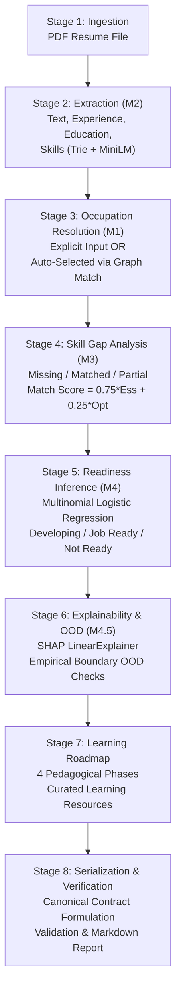

# Road2Hire — 07: AI/ML Engineering Final Handover Document

**Document Version:** 1.0.0  
**Pipeline Engine Version:** 3.0.0  
**Status:** Completed, Stabilized & Verified  
**Target Audience:** Backend Engineers (FastAPI), Database Engineers (PostgreSQL), DevOps/SRE, Frontend Engineers  
**AI/ML Interface Status:** Stable and Verified for Production Integration  

---

## 1. Executive Summary & Verification Status

The Road2Hire AI/ML module is an end-to-end, explainable intelligence engine that assesses candidate resumes against European Skills, Competences, Qualifications and Occupations (**ESCO v1.1.1**) and US **O*NET** occupational taxonomies. It provides structured resume parsing, competency extraction, occupational alignment, three-tier skill gap analysis, career readiness tier prediction with local SHAP feature attributions, empirical out-of-distribution (OOD) boundary detection, personalized candidate knowledge graphs, and sequential four-phase learning roadmaps.

The AI/ML module has achieved complete technical stabilization:
- **Automated Test Suite:** **369 passed out of 369 automated tests (100% pass rate)** in 34.34s.
- **Python Integration Interface:** 18 dedicated integration tests passed in 23.54s (`Tests/AI/test_python_integration_interface.py`).
- **Thread Safety:** Full re-entrant thread safety guaranteed by `threading.RLock` across all shared singletons (`get_pipeline()`, `get_road2hire_model()`).
- **Formal Schema Compliance:** Outputs validated against formal Draft-07 JSON Schemas (`pipeline_output.schema.json` and `pipeline_error.schema.json`).
- **Persistence Specifications:** Complete PostgreSQL relational schema, Mermaid ERD, and column-by-column field mappings provided.

This document serves as the official technical handover guide for engineering teams integrating the AI/ML engine into the broader Road2Hire application.

---

## 2. Completed Components & Directory Map

```text
Road2Hire/
├── AI/
│   ├── Knowledge_Graph/                 # M1/M3: ESCO taxonomy & candidate personalized graph
│   │   ├── esco_graph.py                # Graph querying, hierarchy lookups, NetworkX indexing
│   │   ├── personalized_graph.py        # Personalized NetworkX candidate knowledge subgraph
│   │   └── skill_graph_matcher.py       # Knowledge graph occupation-skill matching
│   ├── Resume_Processing/               # M2: Resume PDF text extraction & document ingestion
│   │   ├── pdf_extractor.py             # PyMuPDF parser, whitespace normalizer, OCR flags
│   │   ├── section_detector.py          # Section boundary & heading regex pattern detector
│   │   └── resume_pipeline.py           # Combined extraction workflow
│   ├── Candidate_Profile/               # M2: CandidateProfile schema v1.1.0 & validation
│   │   ├── profile_schema.py            # CandidateProfile TypedDict schema v1.1.0
│   │   ├── profile_builder.py           # Centralized profile assembly factory
│   │   ├── profile_validator.py         # Schema validator (fatal errors vs. warnings)
│   │   └── section_parsers.py           # Deterministic parsers for edu, exp, proj, certs
│   ├── Skill_Extraction/                # M2: Hybrid dictionary & semantic embedding skill matcher
│   │   ├── skill_extractor.py           # 99k-label Trie + all-MiniLM-L6-v2 vector embeddings
│   │   └── esco_taxonomy.py             # ESCO concepts & normalization lookups
│   ├── Skill_Gap/                       # M3: 3-tier gap detection engine
│   │   ├── skill_gap_detector.py        # Heuristic essential/optional skill gap analyzer
│   │   ├── gap_scoring.py               # Scoring formulas (0.75 Essential + 0.25 Optional)
│   │   └── gap_schema.py                # SkillGapReport data contract
│   ├── Readiness_Model/                 # M4/M4.5: Career Readiness & SHAP Explainability
│   │   ├── inference.py                 # Predictor, feature extractor, OOD detector
│   │   ├── model_trainer.py             # Model training, CV and serialization
│   │   ├── shap_explainer.py            # shap.LinearExplainer for feature log-odds attribution
│   │   └── saved_models/                # Model artifacts (.joblib, metadata, scalers)
│   ├── Pipeline/                        # Central Orchestrator & Public Interfaces
│   │   ├── __init__.py                  # Public exports (process_resume, get_pipeline)
│   │   ├── pipeline.py                  # Road2HirePipeline orchestrator class
│   │   ├── pipeline_schema.py           # UnifiedPipelineResult & to_canonical_dict()
│   │   ├── target_occupation_selector.py# Automatic & explicit target occupation matching
│   │   ├── roadmap_generator.py         # 4-phase pedagogical curriculum builder
│   │   ├── report_generator.py          # Markdown executive summary generator
│   │   ├── cli.py                       # Standalone CLI interface
│   │   └── schemas/                     # Draft-07 JSON Schema contracts
│   │       ├── pipeline_output.schema.json
│   │       └── pipeline_error.schema.json
│   └── road2hire_model.py               # Singleton accessors & warm cache managers
├── Datasets/                            # Curated taxonomy, model training & learning data
│   ├── ESCO_ONET/                       # ESCO v1.1.1 & O*NET taxonomy crosswalks
│   ├── Learning_Resources/              # Curated learning resources (courses, documentation)
│   ├── Readiness_Dataset/               # Training dataset (N=71) and feature definitions
│   └── Skill_Taxonomy/                  # Processed skill taxonomy lookups
├── Docs/                                # Consolidated Documentation Suite
│   ├── 01_AI_ML_Architecture_and_Pipeline.md       # High-level architecture & pipeline flow
│   ├── 02_AI_ML_Research_and_Taxonomy.md          # Research problem, lit review & taxonomy
│   ├── 03_AI_ML_Algorithms_and_Methodology.md     # Formulas, Hungarian match, SHAP math
│   ├── 04_AI_ML_Model_Evaluation_and_Limitations.md# Metrics, benchmarks, 12 limitations
│   ├── 05_AI_ML_Output_and_Integration_Contract.md # Python APIs, Draft-07 schemas & errors
│   ├── 06_AI_ML_Database_Storage_Specification.md # Hybrid persistence, ERD & SQL mappings
│   └── 07_AI_ML_Final_Handover.md                 # This comprehensive handover document
└── Tests/AI/                            # Complete test suite (369 tests, 100% passing)
```

---

## 3. End-to-End Pipeline Execution Sequence



### Stage Summary
1. **Resume Ingestion (M2):** Validates input file, decodes text streams, checks character counts.
2. **Profile & Skill Extraction (M2):** Assembles structured candidate profile (contact, education, experience, projects) and extracts skills using a 99k-node Trie normalized to ESCO concepts.
3. **Occupation Resolution (M1):** Resolves target title or URI against ESCO taxonomy; supports explicit selection or auto-selection (`allow_auto_select=True`).
4. **Skill Gap Analysis (M3):** Computes essential and optional coverage across Tier 1 (exact), Tier 2 (taxonomic graph), and Tier 3 (Hungarian bipartite semantic match).
5. **Readiness Tier Prediction (M4):** Assembles 5-dimensional feature vector; infers readiness tier (`Developing`, `Job Ready`, `Not Ready`) and uncalibrated Softmax probabilities.
6. **SHAP Attribution & OOD Detection (M4.5):** Computes local Shapley feature weights ($\phi_i$) satisfying the Efficiency Axiom. Evaluates feature vector against empirical bounding boxes ($N=71$).
7. **Roadmap Generation:** Synthesizes 4-phase progressive learning curriculum from missing skills with milestones, learning activities, and project scenarios.
8. **Serialization & Contract:** Emits validated canonical JSON payload conforming to `pipeline_output.schema.json` and human-readable Markdown summary.

---

## 4. Public Python Interface Usage

Backend applications should import public functions directly from `AI.Pipeline`:

```python
from AI.Pipeline import process_resume, get_pipeline, Road2HirePipeline
```

### 4.1 Functional Invocation (`process_resume`)

```python
from AI.Pipeline import process_resume

# Example: Processing a candidate resume with an explicit target occupation
result = process_resume(
    resume_path="/path/to/uploaded/candidate_resume.pdf",
    target_occupation="Data Engineer",  # Or canonical ESCO URI
    output_format="none",               # Suppresses file I/O for API performance
    generate_markdown=True,
    allow_auto_select=False,
)

if result["status"] == "success":
    data = result["data"]
    candidate = data["candidate_profile"]
    readiness = data["career_readiness"]
    gaps = data["skill_gap_analysis"]
    
    print(f"Candidate: {candidate['name']}")
    print(f"Target Role: {data['target_occupation']['preferred_label']}")
    print(f"Readiness Tier: {readiness['predicted_class']}")
    print(f"Match Score: {gaps['match_score']:.2f}")
    print(f"Essential Coverage: {gaps['essential_coverage']:.2%}")
else:
    error = result["error"]
    print(f"Pipeline error [{error['stage']}]: {error['message']} (Code: {error['code']})")
```

### 4.2 Automatic Occupation Selection Mode

If a candidate has not selected a target occupation, pass `target_occupation=None` and explicitly enable `allow_auto_select=True`:

```python
result = process_resume(
    resume_path="/path/to/uploaded/candidate_resume.pdf",
    target_occupation=None,
    allow_auto_select=True,  # Mandatory to trigger automatic selection
)
```

> [!WARNING]
> If `target_occupation=None` and `allow_auto_select=False` (default), the pipeline raises `OccupationSelectionError` and returns error code `OCCUPATION_SELECTION_REQUIRED`. Automatic selection will never execute silently.

### 4.3 Singleton Access & Pre-Warming

Loading taxonomy graphs, word vectors, and ML models takes $\approx 14\text{s}$ to $18\text{s}$ (cold start). Once loaded into resident RAM, subsequent inferences execute in $1.8\text{s}$ to $2.5\text{s}$. The backend must **pre-warm** the singleton during application startup:

```python
# FastAPI startup lifespan context
from contextlib import asynccontextmanager
from fastapi import FastAPI
from AI.Pipeline import get_pipeline

@asynccontextmanager
async def lifespan(app: FastAPI):
    # Pre-warm singleton instances
    print("Pre-warming Road2Hire AI/ML singleton...")
    pipeline = get_pipeline()
    pipeline._ensure_graph()
    pipeline._ensure_skill_extractor()
    pipeline._ensure_readiness_model()
    print("Road2Hire AI/ML Engine is ready for inference.")
    yield

app = FastAPI(title="Road2Hire API", lifespan=lifespan)
```

### 4.4 Thread Safety & Concurrency
- `Road2HirePipeline` and underlying singletons (`get_pipeline()`, `get_road2hire_model()`) are protected by re-entrant thread locks (`threading.RLock`).
- Multiple worker threads in the same process can call `process_resume()` concurrently without race conditions or shared state corruption.
- In multi-process worker deployments (e.g. Celery workers or Gunicorn processes), each process initializes its own independent pre-warmed singleton.

---

## 5. Input Requirements & Validation Rules

| Input Parameter | Type | Required | Default | Validation & Error Handling |
| :--- | :--- | :---: | :---: | :--- |
| `resume_path` | `str \| Path` | Yes | — | Must be an existing, readable `.pdf` file. Missing file raises `ResumeValidationError` (`RESUME_NOT_FOUND`). Empty (0-byte) or non-PDF raises `RESUME_PARSE_FAILED`. |
| `target_occupation`| `Optional[str]` | No | `None` | Title string (e.g. `"Data Engineer"`) or canonical ESCO URI. Unresolvable titles raise `OccupationSelectionError` (`OCCUPATION_NOT_FOUND`). |
| `output_format` | `str` | No | `"none"` | `"none"` (suppresses disk I/O in API services), `"json"`, `"markdown"`, or `"both"`. |
| `generate_markdown`| `bool` | No | `True` | Generates full human-readable executive Markdown in `data.report_markdown`. |
| `allow_auto_select`| `bool` | No | `False` | Must be `True` to allow automatic top-occupation selection when `target_occupation=None`. |

---

## 6. Output Contract & Schema Architecture

All outputs conform to formal Draft-07 JSON Schemas:
- **Success Contract:** [`AI/Pipeline/schemas/pipeline_output.schema.json`](file:///c:/Users/Sarvesh%20S.%20Kundale/Road2Hire/AI/Pipeline/schemas/pipeline_output.schema.json)
- **Error Contract:** [`AI/Pipeline/schemas/pipeline_error.schema.json`](file:///c:/Users/Sarvesh%20S.%20Kundale/Road2Hire/AI/Pipeline/schemas/pipeline_error.schema.json)

For detailed field-by-field definitions, JSON payloads, and error mappings, see [05: Output & Integration Contract](file:///c:/Users/Sarvesh%20S.%20Kundale/Road2Hire/Docs/05_AI_ML_Output_and_Integration_Contract.md).

---

## 7. Backend Integration Responsibilities

Backend engineering teams must establish the following operational boundaries:

```
[Client / Frontend]
        │ (1. POST /api/v1/resumes/analyze with Multipart PDF)
        ▼
[FastAPI Gateway]
        │ (2. Validate MIME & save PDF to Object Storage / Local Spool)
        │ (3. Insert record into pipeline_runs [status=PENDING])
        │ (4. Enqueue background task)
        ▼
[Celery / Background Worker Pool]
        │ (5. Invoke process_resume(spool_path, target))
        ▼
[Road2Hire AI/ML Engine (Pre-Warmed Singleton)]
        │ (6. Execute Pipeline M1-M4 -> Return Dict)
        ▼
[Celery / Background Worker Pool]
        │ (7. Persist Hybrid Relational + JSONB in PostgreSQL)
        │ (8. Update pipeline_runs [status=COMPLETED])
        ▼
[Client / Frontend Polling / SSE / WebSocket]
        ▲ (9. Receive Structured JSON Analysis)
```

### Operational Boundaries:
1. **HTTP Ingestion Security:** Enforce maximum file upload size ($10\text{ MB}$), validate MIME type (`application/pdf`) and magic bytes, and sanitize filenames.
2. **Asynchronous Execution:** Because full analysis takes $1.8\text{s}$ to $2.5\text{s}$, **never invoke `process_resume()` synchronously inside an HTTP request thread**. Always dispatch execution via Celery or background worker queues.
3. **Database Transaction Management:** Store analysis results using the hybrid persistence schema specified in [06: Database Storage Specification](file:///c:/Users/Sarvesh%20S.%20Kundale/Road2Hire/Docs/06_AI_ML_Database_Storage_Specification.md).
4. **Error Handling & HTTP Mapping:** Map pipeline error codes (`RESUME_PARSE_FAILED`, `OCCUPATION_NOT_FOUND`) to appropriate HTTP status codes (400, 404, 422).

---

## 8. Database Handover References

Full database architectural specifications are provided in [06: Database Storage Specification](file:///c:/Users/Sarvesh%20S.%20Kundale/Road2Hire/Docs/06_AI_ML_Database_Storage_Specification.md):
- **Hybrid Persistence Model:** Relational columns for fast dashboard querying + PostgreSQL `JSONB` for granular nested structures.
- **7 Core Entities:** `candidates`, `resumes`, `occupations`, `pipeline_runs`, `candidate_skills`, `skill_gaps`, `learning_roadmaps`.
- **Column-by-Column Field Mapping:** Exact PostgreSQL types mapped from canonical JSON paths.
- **High-Throughput Indexing:** $B$-Tree and GIN indexing strategies.

---

## 9. Summary of Known Scientific Limitations & Disclaimers

Before exposing pipeline outputs in production user interfaces, engineering and product teams must observe the scientific boundaries detailed in [04: Model Evaluation & Limitations](file:///c:/Users/Sarvesh%20S.%20Kundale/Road2Hire/Docs/04_AI_ML_Model_Evaluation_and_Limitations.md):

1. **Uncalibrated Model Scores:** Softmax probabilities emitted under `data.career_readiness.class_probabilities` are heuristic model scores on an annotated dataset ($N=71$). **They must never be presented as hiring probabilities, confidence percentages, or employment guarantees.**
2. **Deterministic Heuristic Matching:** The M3 match score ($0.75 \times \text{Essential} + 0.25 \times \text{Optional}$) is a structured alignment indicator, not an empirical proof of real-world job performance.
3. **Local Explainability Attribution:** SHAP attributions reflect mathematical feature credit relative to training base rates; they do not establish causal factors for hiring.
4. **Scanned PDF Ingestion:** Pure scanned/image PDFs without embedded text streams cannot be parsed by `pypdf` and will return `RESUME_PARSE_FAILED`.
5. **Human-in-the-Loop Requirement:** Road2Hire is an advisory decision-support tool. Final evaluations must remain in the hands of human recruiters and academic mentors.

---

## 10. Handover Checklist for Backend & Frontend Teams

### Backend Team Checklist
- [ ] Install production dependencies from `requirements.txt` into the backend environment.
- [ ] Add `AI/` to `PYTHONPATH` or install Road2Hire as an editable package (`pip install -e .`).
- [ ] Implement pre-warming singleton hook (`get_pipeline()`) in FastAPI startup lifespan handler.
- [ ] Implement secure PDF file upload handler with MIME validation and temporary spool storage.
- [ ] Configure background task queue (Celery/Redis) to execute `process_resume()`.
- [ ] Implement database migration applying the hybrid relational + JSONB schema from [06: Database Storage Specification](file:///c:/Users/Sarvesh%20S.%20Kundale/Road2Hire/Docs/06_AI_ML_Database_Storage_Specification.md).
- [ ] Implement persistence worker saving `process_resume()` outputs into PostgreSQL.
- [ ] Implement error handling mapping `pipeline_error.schema.json` codes to client responses.

### Frontend Team Checklist
- [ ] Build resume upload component supporting standard text-layer PDF documents.
- [ ] Provide target occupation selector with search-as-you-type querying ESCO titles.
- [ ] Display explicit disclaimer: *"Readiness scores are AI model estimations based on resume content, not hiring guarantees."*
- [ ] Render 3-tier skill gaps (Missing, Matched, Partially Matched) with visual distinction.
- [ ] Render SHAP feature attributions as positive and negative impact drivers.
- [ ] Render 4-phase learning roadmap with expandable milestones and course links.
- [ ] Display OOD warning banner if `data.career_readiness.is_ood` is `true`.
- [ ] Display `data.report_markdown` in an accessible Markdown viewer or tab.

---

## 11. Complete Documentation Suite Index

1. [`01_AI_ML_Architecture_and_Pipeline.md`](file:///c:/Users/Sarvesh%20S.%20Kundale/Road2Hire/Docs/01_AI_ML_Architecture_and_Pipeline.md): System architecture, execution stages, and directory structure.
2. [`02_AI_ML_Research_and_Taxonomy.md`](file:///c:/Users/Sarvesh%20S.%20Kundale/Road2Hire/Docs/02_AI_ML_Research_and_Taxonomy.md): Research problem, literature review, and ESCO/O*NET taxonomy strategy.
3. [`03_AI_ML_Algorithms_and_Methodology.md`](file:///c:/Users/Sarvesh%20S.%20Kundale/Road2Hire/Docs/03_AI_ML_Algorithms_and_Methodology.md): Algorithmic formulas, Hungarian matching, candidate graph, and SHAP math.
4. [`04_AI_ML_Model_Evaluation_and_Limitations.md`](file:///c:/Users/Sarvesh%20S.%20Kundale/Road2Hire/Docs/04_AI_ML_Model_Evaluation_and_Limitations.md): Cross-validation metrics, external benchmarks, and 12 scientific limitations.
5. [`05_AI_ML_Output_and_Integration_Contract.md`](file:///c:/Users/Sarvesh%20S.%20Kundale/Road2Hire/Docs/05_AI_ML_Output_and_Integration_Contract.md): Public Python interface, Draft-07 schemas, and FastAPI integration guide.
6. [`06_AI_ML_Database_Storage_Specification.md`](file:///c:/Users/Sarvesh%20S.%20Kundale/Road2Hire/Docs/06_AI_ML_Database_Storage_Specification.md): Hybrid persistence schema, Mermaid ERD, and PostgreSQL data mapping.
7. [`07_AI_ML_Final_Handover.md`](file:///c:/Users/Sarvesh%20S.%20Kundale/Road2Hire/Docs/07_AI_ML_Final_Handover.md): This comprehensive engineering handover document and checklist.
