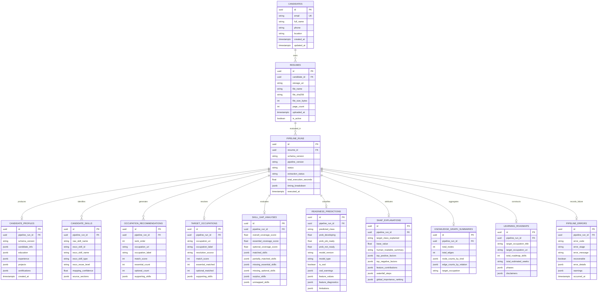

# Road2Hire — AI/ML Database Storage Specification & Backend Data Architecture

**Specification Version:** 1.0.0  
**Contract Version:** `1.0.0` (Draft-07 JSON Schema)  
**Pipeline Version:** `3.0.0`  
**Target Audience:** Backend Engineering, Data Engineering, API Team  
**Status:** AI/ML Team Recommendation & System Handover Specification  

---

> [!NOTE]
> **Implementation Scope & Architectural Boundary:**  
> This document specifies the database storage requirements, entity relationships, data lifecycle, and data mapping from the perspective of the Road2Hire AI/ML engineering team.  
> The database entities, column names, constraints, and data types defined herein are **technical recommendations and architectural guidelines**, not pre-existing backend code. The AI/ML pipeline produces in-memory, Draft-07 schema-compliant Python dictionaries (`UnifiedPipelineResult.to_canonical_dict()`). Persistence, database migrations, and connection pools are managed by the backend service.

---

## 1. Architectural Overview & Storage Strategy

The Road2Hire Career Readiness platform processes unstructured candidate resume PDFs and generates structured, multi-dimensional talent intelligence. The output spans:
- High-level execution metadata and extraction health
- Structured candidate profiles (Schema v1.1.0)
- Verified technical skills and canonical ESCO taxonomy mappings
- Ranked occupation compatibility recommendations
- Canonical target occupation resolution
- 3-tier hybrid skill gap scores and missing requirements
- Supervised career readiness predictions and empirical Out-of-Distribution (OOD) diagnostics
- Exact SHAP local feature attributions and global macro rankings
- Personalized knowledge graph topology summaries
- Prioritized 4-phase learning roadmaps with concrete milestones

### The Hybrid Storage Pattern (Relational + JSONB)

To optimize query performance, analytical reporting, and architectural maintainability, Road2Hire recommends a **hybrid relational and document (JSONB) persistence model** in PostgreSQL:

```
┌─────────────────────────────────────────────────────────────────────────────┐
│                       ROAD2HIRE HYBRID PERSISTENCE MODEL                    │
├─────────────────────────────────────────────────────────────────────────────┤
│                                                                             │
│  [Normalized Relational Storage]         [Indexed Semi-Structured JSONB]    │
│  ├── Filterable IDs & Foreign Keys       ├── Complex Nested Documents       │
│  ├── Execution Status & Timestamps       ├── Candidate Profile Sections     │
│  ├── Numeric Readiness Probabilities     ├── Detailed Waterfall Steps       │
│  ├── Weighted Skill Gap Coverage Scores  ├── 4-Phase Roadmap Curricula      │
│  └── Indexed Skills & Occupations        └── Diagnostics & Limitations      │
│                                                                             │
│  Rationale: High-frequency SQL filters   Rationale: Flexible schemas,       │
│  and joins (e.g. "Find all Job Ready     avoids 20+ normalization tables,   │
│  candidates for Data Engineer with       fast single-query document read    │
│  coverage > 75%").                       for frontend dashboard rendering.  │
│                                                                             │
└─────────────────────────────────────────────────────────────────────────────┘
```

---

## 2. Entity-Relationship Model (Mermaid ERD)

The following diagram illustrates the suggested relational model connecting candidates, resumes, execution runs, and the 10 logical AI/ML output modules:



---

## 3. Data Storage and Lifecycle Management

### 3.1 Candidate & Resume Cardinality
- **One Candidate to Many Resumes ($1:N$):** Candidates frequently upload revised resumes over time (e.g. after gaining new skills or degrees).
- **One Resume to Many Pipeline Runs ($1:N$):** A single resume document may be analyzed multiple times:
  - Evaluated against different target occupations (e.g. *Data Engineer* vs. *Data Analyst*).
  - Reprocessed with an upgraded pipeline or retrained model version.
- **Append-Only Run Architecture:** Every invocation of `process_resume()` or `pipeline.run()` should create a **new `pipeline_runs` row**. Previous runs must **never be overwritten**. This provides an immutable historical audit log of career readiness progression.

### 3.2 Reprocessing & Idempotency
- When a user requests re-analysis for the same resume and same target occupation:
  1. Generate a new `pipeline_run_id` (UUIDv4).
  2. Record the exact `pipeline_version` (`3.0.0`) and `schema_version` (`1.0.0`).
  3. Mark previous runs for the same target occupation as `is_latest = FALSE` (or query with `ORDER BY executed_at DESC LIMIT 1`).
- **Target Role Switching Optimization:**
  - If a user changes their target occupation without uploading a new resume, the backend can re-run stages 2 through 10 using the cached `resume_result` or re-execute `pipeline.run(resume_path, new_target)` directly. Total re-run duration with warm models is ~1.5s.

### 3.3 Handling Failed Executions
- When the AI/ML pipeline encounters an unrecoverable failure (e.g. `ResumeValidationError` or `OccupationSelectionError`):
  - Do not drop the request. Record a `pipeline_runs` record with `status = 'error'`.
  - Store the structured error payload in `pipeline_errors` conforming to [`pipeline_error.schema.json`](file:///c:/Users/Sarvesh%20S.%20Kundale/Road2Hire/AI/Pipeline/schemas/pipeline_error.schema.json).
  - The `recoverable` boolean field informs the frontend whether to prompt the user (e.g. pick a suggested occupation title) or display a terminal error.

---

## 4. Data Integrity, Privacy & Security (PII)

### 4.1 PII Storage Boundaries
- Resume text contains sensitive Personally Identifiable Information (Full name, personal email, phone number, physical address, employment history).
- **Separation of Concerns:**
  - **Raw PDF Files:** Store in secure object storage (e.g. AWS S3, Google Cloud Storage, or MinIO) with private access policies and pre-signed URLs. The database should store only the `storage_uri` and SHA-256 hash.
  - **Candidate Contact Data:** Extracted PII in `candidate_profiles` (`candidate_info`) should be restricted via database column-level permissions or encrypted at rest (PostgreSQL `pgcrypto`).
  - **De-identified AI/ML Analytics:** Analytical entities (`readiness_predictions`, `skill_gap_analyses`, `shap_explanations`) contain zero candidate PII—only skill names, scores, feature values, and mathematical attributions.

### 4.2 Referential Integrity & Suggested Cascade Rules
- **Suggested Foreign Key Cascades:** The backend database schema may configure `ON DELETE CASCADE` from `candidates` to `resumes` to `pipeline_runs` and child analysis records.
  - If the application implements candidate deletion workflows (e.g. upon user account removal), cascading foreign keys ensure that child analysis runs, extracted skills, and roadmaps do not remain orphaned.
  - Note: Regulatory, privacy, or legal data retention compliance policies are application-level concerns to be defined and implemented by the backend and compliance teams.
- **Master Taxonomy Integrity:**
  - Canonical ESCO concept URIs (`http://data.europa.eu/esco/...`) should reference static lookup tables or remain unconstrained URIs.

### 4.3 Validation Prior to Persistence
- The backend should execute Draft-07 JSON validation using `pipeline_output.schema.json` prior to committing data to PostgreSQL. The AI/ML pipeline provides verified schema compliance out-of-the-box via `result.to_canonical_dict()`.

---

## 5. Backend Handover & Scientific Interpretation Guidelines

To prevent misrepresenting AI/ML model capabilities in frontend dashboards, the backend and product teams must enforce the following scientific interpretation rules:

### 5.1 Skill Gap Coverage (M3) Is a Heuristic Score
- **Formula:** $\text{Overall Coverage} = 0.75 \times \text{Essential Coverage} + 0.25 \times \text{Optional Coverage}$.
- **Guideline:** This score measures lexical and semantic alignment between the candidate's declared resume skills and the ESCO knowledge graph requirements. It is a curriculum guide, not a proof of professional competence.

### 5.2 M4 Readiness Probabilities Are Uncalibrated Estimates
- **Multinomial Logistic Regression:** The output probabilities (`prob_developing`, `prob_job_ready`, `prob_not_ready`) sum to 1.0 via Softmax.
- **Guideline:** These values are heuristic Softmax estimates across three discrete profile-depth categories based on an exploratory training cohort ($N=71$). They are **uncalibrated model heuristic scores, NOT calibrated confidence metrics and NOT real-world hiring probabilities**. The backend and UI must explicitly describe them as *"Uncalibrated Model Estimates"* or *"Relative Profile-Depth Scores"*, and never present them as *"Calibrated Confidence"*, *"Hiring Likelihood"*, or *"78% Chance of Hire"*.

### 5.3 Out-of-Distribution (OOD) Warnings Must Be Surfaced
- When `readiness_predictions.is_ood == TRUE`, the candidate's resume features (e.g. unusually high skill count or long tenure) exceed the training dataset boundaries.
- **Guideline:** Backend API responses must include `ood_warnings` and frontend views must display an advisory banner indicating that predictions are based on statistical extrapolation.

### 5.4 SHAP Attributions ($\phi_i$) Are Local Feature Weights, Not Causes
- SHAP values measure how much each extracted structural signal shifted the model's log-odds relative to the base value.
- **Guideline:** Top positive factors (e.g. *Verified Skill Breadth*) explain the model's classification; they do not imply that acquiring one more skill will automatically flip the candidate's readiness state.

### 5.5 Occupation Compatibility vs. Career Readiness
- **Occupation Recommendation Score (M2/M3):** Measures domain similarity (e.g. *"This profile matches Data Engineer skills by 85%"*).
- **Career Readiness (M4):** Measures structural seniority and evidence depth (e.g. *"Candidate is Developing towards independent industry practice"*).
- **Guideline:** A candidate can have 90% compatibility with an occupation while remaining in the *Developing* readiness stage due to limited production experience. Keep these concepts decoupled in backend APIs.

