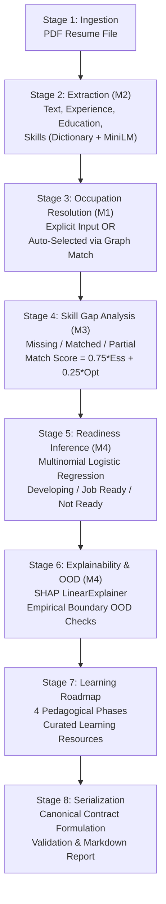

# Road2Hire AI/ML Engine: Final Technical Handover Document

**Document Version:** 1.0.0  
**Phase:** Phase 7 — Final Testing, Documentation & AI/ML Handover  
**Target Audience:** Backend Engineers (FastAPI), Database Engineers (PostgreSQL), DevOps/SRE, Frontend Engineers  
**AI/ML Interface Status:** Stable, Verified, and Ready for Integration  

---

## 1. Executive Summary & Architecture Overview

The Road2Hire AI/ML module is an end-to-end, explainable intelligence engine designed to assess candidate resumes against European Skills, Competences, Qualifications and Occupations (ESCO v1.1.1) and US O*NET occupational taxonomies. It provides structured skill extraction, occupational alignment, three-tier skill gap analysis, career readiness prediction with local SHAP feature attributions, out-of-distribution (OOD) boundary detection, personalized candidate knowledge graphs, and sequential four-phase learning roadmaps.

The AI/ML module has achieved complete technical stabilization:
- **Test Suite:** 369 passed out of 369 automated unit, integration, and contract tests (100% pass rate).
- **Public Python Interface:** Reusable, thread-safe Python entry point (`process_resume`, `get_pipeline`) protected by re-entrant locking (`threading.RLock`).
- **Data Validation:** Strict canonical JSON contract validated against formal Draft-07 JSON Schemas (`pipeline_output.schema.json` and `pipeline_error.schema.json`).
- **Persistence Specifications:** Detailed database storage requirements, entity-relationship diagrams, and column-by-column field mappings provided for backend implementation.

This handover document provides backend and engineering teams with all specifications, architectural details, operational guidelines, and checklists required to integrate the AI/ML module into the Road2Hire application.

---

## 2. Completed Components & Directory Map

The AI/ML codebase is organized into modular packages under the `AI/` directory:

```
Road2Hire/
├── AI/
│   ├── Knowledge_Graph/                 # M1: ESCO/O*NET Knowledge Graph & Neo4j/NetworkX logic
│   │   ├── esco_graph_manager.py        # Graph querying, taxonomy hierarchy & traversals
│   │   └── esco_data_loader.py          # ESCO CSV parsing & relationship indexing
│   ├── Resume_Extraction/               # M2: Resume PDF text extraction & document ingestion
│   │   └── extractor.py                 # PDF parsing, stream decoding, error handling
│   ├── Candidate_Profile/               # M2: Profile structuring, education & experience normalization
│   │   ├── candidate_profile.py         # CandidateProfile dataclass & validator
│   │   └── candidate_profile_builder.py # Aggregation of extracted resume sections
│   ├── Skill_Extraction/                # M2: Hybrid dictionary & semantic embedding skill matcher
│   │   └── skill_extractor.py           # all-MiniLM-L6-v2 vector embeddings & token matching
│   ├── Skill_Gap_Detection/             # M3: 3-tier gap detection & candidate graph generation
│   │   ├── gap_detector.py              # Heuristic essential/optional skill gap analyzer
│   │   └── candidate_graph_generator.py # Personalized NetworkX candidate knowledge subgraph
│   ├── Readiness_Model/                 # M4: L2 Multinomial Logistic Regression & Inference
│   │   ├── inference.py                 # Predictor, feature extractor, OOD detector
│   │   ├── ood_detector.py              # Empirical univariate bounding box OOD checks
│   │   └── saved_models/                # Model artifacts (.joblib, metadata, scalers)
│   ├── Explainability/                  # M4: Local SHAP explanations
│   │   └── shap_explainer.py            # shap.LinearExplainer for feature log-odds attribution
│   ├── Pipeline/                        # End-to-End Orchestrator & Public Interfaces
│   │   ├── __init__.py                  # Public exports (process_resume, get_pipeline)
│   │   ├── pipeline.py                  # Road2HirePipeline orchestrator class
│   │   ├── pipeline_schema.py           # PipelineResult dataclass & to_canonical_dict()
│   │   ├── target_occupation_selector.py# Automatic target occupation matching heuristic
│   │   ├── roadmap_generator.py         # 4-phase pedagogical curriculum builder
│   │   ├── report_generator.py          # Markdown executive summary generator
│   │   ├── cli.py                       # Standalone CLI interface (python -m AI.Pipeline.cli)
│   │   └── schemas/                     # Draft-07 JSON Schema contracts
│   │       ├── pipeline_output.schema.json
│   │       └── pipeline_error.schema.json
│   └── road2hire_model.py               # Singleton accessors & warm cache managers
├── Datasets/                            # Curated taxonomy, model training & learning data
│   ├── ESCO_ONET/                       # ESCO v1.1.1 & O*NET taxonomy crosswalks
│   ├── Learning_Resources/              # Curated learning resources (courses, documentation)
│   ├── Readiness_Dataset/               # Training dataset (N=71) and feature definitions
│   └── Skill_Taxonomy/                  # Processed skill taxonomy lookups
├── Docs/                                # Architectural & Integration Documentation
│   ├── AI_ML_Pipeline_Integration_Guide.md     # Step-by-step developer integration guide
│   ├── AI_ML_Output_Contract.md                # Field-by-field JSON contract documentation
│   ├── AI_ML_Database_Storage_Specification.md # Hybrid persistence architecture & ERD
│   ├── AI_ML_Database_Field_Mapping.md         # PostgreSQL type mapping & indexing strategy
│   ├── AI_ML_Limitations_and_Future_Work.md    # 12 scientific & engineering limitations
│   └── AI_ML_Final_Handover.md                 # This comprehensive handover document
└── Tests/AI/                            # Complete test suite (369 tests, 100% passing)
```

---

## 3. End-to-End Pipeline Execution Sequence

When an analysis is requested, `Road2HirePipeline.run()` executes an eight-stage sequential pipeline:



### Stage Details:
1. **Resume Text Extraction (M2):** Validates PDF file existence, decodes text streams, verifies non-empty content.
2. **Profile & Skill Extraction (M2):** Parses contact metadata, work history, and education. Identifies skills via token exact matching and semantic embedding cosine similarity.
3. **Target Occupation Resolution (M1):** If `target_occupation` is provided, resolves name or ESCO URI against taxonomy graph. If `target_occupation=None` and `allow_auto_select=True`, evaluates top candidate skills against all ESCO occupations to select the highest-scoring role.
4. **Skill Gap Analysis (M3):** Computes essential and optional skill coverage. Categorizes every occupation skill into `missing`, `matched`, or `partially_matched`. Produces candidate subgraph metrics.
5. **Career Readiness Inference (M4):** Assembles a 5-dimensional feature vector (`skill_overlap_ratio`, `years_experience`, `education_level_numeric`, `essential_skill_coverage`, `optional_skill_coverage`). Infers readiness class and uncalibrated Softmax probability distribution.
6. **SHAP Attribution & OOD Detection (M4):** Computes additive local Shapley feature weights ($\phi_i$) for the predicted class log-odds. Checks feature vector against empirical bounding boxes; emits warning if out-of-distribution.
7. **Learning Roadmap Generation:** Maps missing essential and optional skills to four sequential learning phases, fetching curated course resources, durations, and milestones.
8. **Serialization & Canonical Contract:** Packages all results into the immutable `PipelineResult` object, validates structure, and generates markdown summary report.

---

## 4. Public Python Interface Usage

The backend application should directly import the public interface from `AI.Pipeline`:

```python
from AI.Pipeline import process_resume, get_pipeline, Road2HirePipeline
```

### Primary Entry Point: `process_resume()`

`process_resume()` is a functional wrapper that handles pipeline lifecycle, execution, and error formatting, returning a canonical JSON-serializable dictionary:

```python
from AI.Pipeline import process_resume

# Example 1: Explicit target occupation (by title or ESCO URI)
result = process_resume(
    resume_path="/path/to/uploaded/candidate_resume.pdf",
    target_occupation="Data Engineer",  # or ESCO URI
    generate_markdown=True,
    allow_auto_select=False,
)

if result["status"] == "success":
    data = result["data"]
    candidate = data["candidate_profile"]
    readiness = data["career_readiness"]
    print(f"Candidate: {candidate['name']}")
    print(f"Target: {data['target_occupation']['preferred_label']}")
    print(f"Readiness Tier: {readiness['predicted_class']}")
    print(f"Match Score: {data['skill_gap_analysis']['match_score']:.2f}")
else:
    error = result["error"]
    print(f"Pipeline failed at [{error['stage']}]: {error['message']} (Code: {error['code']})")
```

### Automatic Occupation Selection

When a candidate does not select a target occupation, pass `target_occupation=None` and enable `allow_auto_select=True`:

```python
result = process_resume(
    resume_path="/path/to/uploaded/candidate_resume.pdf",
    target_occupation=None,
    allow_auto_select=True,  # Mandatory to trigger automatic selection
)
```

> [!IMPORTANT]
> If `target_occupation=None` and `allow_auto_select=False` (the default), the pipeline raises an `InvalidInputError` and returns structured error code `INVALID_OCCUPATION_SPECIFICATION`. Automatic selection will never execute silently.

### Singleton Pipeline Access & Pre-Warming

Loading taxonomy graphs, word vectors, and ML models requires $\approx 14\text{s}$ to $18\text{s}$ (cold start). To prevent request timeouts during live user interactions, the backend must **pre-warm** the singleton during application startup:

```python
# FastAPI startup lifecycle event
from contextlib import asynccontextmanager
from fastapi import FastAPI
from AI.Pipeline import get_pipeline

@asynccontextmanager
async def lifespan(app: FastAPI):
    # PRE-WARM: Load all ML models, ESCO graphs, and SHAP explainers into memory
    print("Pre-warming Road2Hire AI/ML singleton...")
    pipeline = get_pipeline()
    pipeline._ensure_graph()
    pipeline._ensure_skill_extractor()
    pipeline._ensure_readiness_model()
    print("Road2Hire AI/ML Engine is ready for inference.")
    yield
    # Cleanup if necessary

app = FastAPI(lifespan=lifespan)
```

### Thread Safety & Concurrency

- `Road2HirePipeline` and its underlying singletons (`get_pipeline()`, `get_road2hire_model()`) are protected by re-entrant thread locks (`threading.RLock`).
- Multiple worker threads within the same Python process can safely invoke `process_resume()` concurrently without race conditions or shared state corruption.
- In multi-process deployments (e.g., Gunicorn/Uvicorn with multiple workers or Celery workers), each OS process maintains its own independent, pre-warmed singleton instance.

---

## 5. Input Requirements & Validation

| Parameter | Type | Required | Default | Validation Rules & Constraints |
| :--- | :--- | :---: | :---: | :--- |
| `resume_path` | `str` or `Path` | Yes | — | Must be an existing, readable `.pdf` file. Non-existent paths raise `ResumeExtractionError` (`RESUME_NOT_FOUND`). Corrupted or empty PDFs raise `RESUME_PARSE_FAILED`. |
| `target_occupation` | `Optional[str]` | No | `None` | Case-insensitive title (e.g. `"Data Engineer"`) or canonical ESCO URI. Non-existent titles raise `InvalidInputError` (`OCCUPATION_NOT_FOUND`). |
| `generate_markdown` | `bool` | No | `True` | Generates a human-readable markdown executive summary in `report_markdown`. Set to `False` to reduce CPU overhead. |
| `allow_auto_select` | `bool` | No | `False` | Must be explicitly `True` to allow automated matching when `target_occupation=None`. |

---

## 6. Output Contract & Schema Architecture

All outputs conform strictly to Draft-07 JSON Schemas located in `AI/Pipeline/schemas/`.

### Success Response (`status: "success"`)
Schema: `AI/Pipeline/schemas/pipeline_output.schema.json`

```json
{
  "pipeline_version": "1.0.0",
  "execution_timestamp": "2026-11-07T15:45:00.123456+00:00",
  "status": "success",
  "data": {
    "metadata": { ... },
    "candidate_profile": { ... },
    "extracted_skills": [ ... ],
    "target_occupation": { ... },
    "top_matching_occupations": [ ... ],
    "skill_gap_analysis": { ... },
    "career_readiness": { ... },
    "explainability": { ... },
    "knowledge_graph": { ... },
    "learning_roadmap": { ... },
    "report_markdown": "# Road2Hire Career Readiness Report\n..."
  }
}
```

### Canonical Data Sections Summary:
1. `metadata`: Ingestion file name, path, schema version, execution latency, selection mode (`explicit` or `auto_selected`).
2. `candidate_profile`: Contact details, education records, work history experiences, calculated total experience years.
3. `extracted_skills`: Normalized skill list with categories, confidence, and source contexts.
4. `target_occupation`: Chosen occupation's canonical title, ESCO URI, code, and description.
5. `top_matching_occupations`: Top 5 graph-matched alternative occupations with match scores.
6. `skill_gap_analysis`: Match score, essential coverage, optional coverage, and partitioned lists of missing, matched, and partial skills.
7. `career_readiness`: Predicted readiness tier (`Developing`, `Job Ready`, `Not Ready`), uncalibrated Softmax probabilities, feature vector values, and OOD detection flags.
8. `explainability`: SHAP predicted class log-odds, base value, and ordered feature attributions (`positive_contributors`, `negative_contributors`).
9. `knowledge_graph`: Candidate-specific subgraph node counts, edge counts, and personalized relationships.
10. `learning_roadmap`: 4 sequential phases with prioritized milestones, learning activities, course resources, and durations.

### Structured Error Response (`status: "error"`)
Schema: `AI/Pipeline/schemas/pipeline_error.schema.json`

```json
{
  "pipeline_version": "1.0.0",
  "execution_timestamp": "2026-11-07T15:45:00.123456+00:00",
  "status": "error",
  "error": {
    "code": "OCCUPATION_NOT_FOUND",
    "message": "Target occupation 'Quantum Wizard' could not be resolved in the ESCO taxonomy.",
    "stage": "occupation_resolution",
    "details": {
      "input_occupation": "Quantum Wizard"
    }
  }
}
```

---

## 7. Backend Integration Responsibilities

The backend development team must implement the following operational boundaries around the AI/ML module:

```
[Client / Frontend]
        │ (1. POST /api/v1/resumes/analyze with Multipart PDF)
        ▼
[FastAPI Gateway]
        │ (2. Save PDF to Object Storage / Local Spool)
        │ (3. Create DB Candidate & PipelineRun [status=PENDING])
        │ (4. Enqueue task)
        ▼
[Celery / Background Worker Pool]
        │ (5. Invoke process_resume(spool_path, target))
        ▼
[Road2Hire AI/ML Engine (Pre-Warmed Singleton)]
        │ (6. Execute Pipeline M1-M4 -> Return Dict)
        ▼
[Celery / Background Worker Pool]
        │ (7. Persist Hybrid Relational + JSONB in PostgreSQL)
        │ (8. Update PipelineRun [status=COMPLETED])
        ▼
[Client / Frontend Polling / SSE / WebSocket]
        ▲ (9. Receive Structured JSON Analysis)
```

### Core Backend Tasks:
1. **HTTP Ingestion & Security Validation:**
   - Enforce file size limits (e.g., maximum $10\text{ MB}$).
   - Validate MIME types (`application/pdf`) and magic bytes to prevent arbitrary binary upload attacks.
   - Sanitize uploaded filenames and store PDFs in secure object storage (e.g., AWS S3, MinIO) or dedicated temporary spools with UUID paths.
2. **Asynchronous Task Queue Execution:**
   - Resume processing takes $1.5\text{s}$ to $2.5\text{s}$ warm ($15\text{s}$ cold). **Never run `process_resume()` synchronously inside an HTTP request/response thread.**
   - Dispatch pipeline execution via Celery, ARQ, or Redis Queue (RQ).
   - Use Server-Sent Events (SSE), WebSockets, or polling endpoints (`GET /api/v1/analyses/{run_id}`) to notify the client of completion.
3. **Database Transaction Management:**
   - Store results using the hybrid persistence schema specified in `Docs/AI_ML_Database_Storage_Specification.md`.
   - Ensure foreign key associations link `candidate_skills`, `skill_gaps`, and `pipeline_runs` to the specific `run_id`.
   - Wrap persistence operations in database transactions so partial insertion failures roll back cleanly.
4. **Error Handling & Graceful Degradation:**
   - When the pipeline returns `status: "error"`, write the error details (`error.code`, `error.message`, `error.stage`) to `pipeline_runs.error_message` and set status to `FAILED`.
   - Never expose raw Python tracebacks to external API clients. Map pipeline error codes to user-friendly HTTP responses (e.g., `OCCUPATION_NOT_FOUND` $\to$ HTTP 404/422).

---

## 8. Database Handover References

Detailed database specifications have been authored and placed in `Docs/`:

1. **[`Docs/AI_ML_Database_Storage_Specification.md`](file:///c:/Users/Sarvesh%20S.%20Kundale/Road2Hire/Docs/AI_ML_Database_Storage_Specification.md):**
   - Architectural justification for a **Hybrid Relational + Document (PostgreSQL JSONB)** model.
   - Complete Mermaid Entity-Relationship Diagram (ERD) defining 7 core entities:
     - `candidates` (Candidate identity & contact details)
     - `resumes` (Uploaded PDF metadata & storage URI)
     - `pipeline_runs` (Run lifecycle, status, latency, overall metrics, error codes)
     - `occupations` (ESCO canonical occupation cache)
     - `candidate_skills` (Extracted skills with normalization & source context)
     - `skill_gaps` (Missing/matched/partial skills for relational filtering)
     - `learning_roadmaps` (Relational roadmap header with phases)
   - Lifecycle management, indexing strategies, and compliance guidelines.
2. **[`Docs/AI_ML_Database_Field_Mapping.md`](file:///c:/Users/Sarvesh%20S.%20Kundale/Road2Hire/Docs/AI_ML_Database_Field_Mapping.md):**
   - Exact mapping table from every canonical JSON path (e.g., `data.career_readiness.predicted_class`) to proposed PostgreSQL columns and types (`VARCHAR`, `NUMERIC`, `JSONB`).
   - Query examples for dashboard analytics, skill gap filtering, and candidate search.

---

## 9. Summary of Known Scientific Limitations & Disclaimers

Before exposing pipeline outputs in production user interfaces, ensure product teams and frontend developers understand the scientific boundaries detailed in `Docs/AI_ML_Limitations_and_Future_Work.md`:

1. **Uncalibrated Model Scores:** Softmax probabilities emitted under `data.career_readiness.class_probabilities` are uncalibrated model heuristic scores. **They must never be presented as hiring probabilities, confidence percentages, or employment guarantees.**
2. **Deterministic Heuristic Matching:** The M3 match score ($0.75 \times \text{Essential} + 0.25 \times \text{Optional}$) is a structured alignment indicator, not an empirical proof of real-world job performance.
3. **Local Explainability Attribution:** SHAP attributions reflect mathematical feature credit relative to training base rates; they do not establish causal factors for hiring.
4. **Scanned PDF Ingestion:** Pure scanned/image PDFs without embedded text streams cannot be parsed by `pypdf` and will return `RESUME_PARSE_FAILED`.
5. **Human-in-the-Loop Requirement:** In compliance with responsible AI principles, the pipeline is an advisory decision-support tool. Final hiring evaluations must remain in the hands of human recruiters.

---

## 10. Handover Checklist for Backend & Frontend Teams

### Backend Team Checklist
- [ ] Add `AI/` to `PYTHONPATH` or install Road2Hire as an editable package (`pip install -e .`).
- [ ] Install production dependencies from `requirements.txt` into the backend environment.
- [ ] Implement pre-warming singleton hook (`get_pipeline()`) in FastAPI startup lifespan handler.
- [ ] Implement secure PDF file upload handler with MIME validation and temporary spool storage.
- [ ] Configure background task queue (Celery/Redis) to execute `process_resume()`.
- [ ] Implement database migration applying the hybrid relational + JSONB schema from `Docs/AI_ML_Database_Storage_Specification.md`.
- [ ] Implement persistence worker saving `process_resume()` outputs into PostgreSQL.
- [ ] Implement error handling mapping `pipeline_error.schema.json` codes to client responses.

### Frontend Team Checklist
- [ ] Build resume upload component supporting standard text-layer PDF documents.
- [ ] Provide target occupation selector with search-as-you-type querying ESCO titles.
- [ ] Display explicit disclaimer: *"Readiness scores are AI model estimations based on resume content, not hiring guarantees."*
- [ ] Render 3-tier skill gaps (Missing, Matched, Partially Matched) with visual distinction.
- [ ] Render SHAP feature attributions as positive and negative impact drivers.
- [ ] Render 4-phase learning roadmap with expandable milestones and course links.
- [ ] Display OOD warning banner if `data.career_readiness.is_ood` is `true`.
- [ ] Display `data.report_markdown` in an accessible Markdown viewer or tab.

---

*This document marks the official technical handover of the Road2Hire AI/ML Engine. The AI/ML engineering team remains available for consultation during backend API wiring and database migration execution.*

