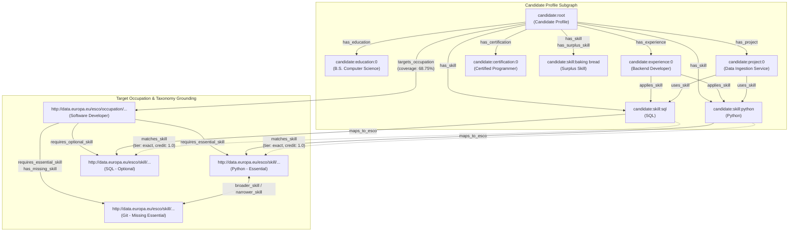
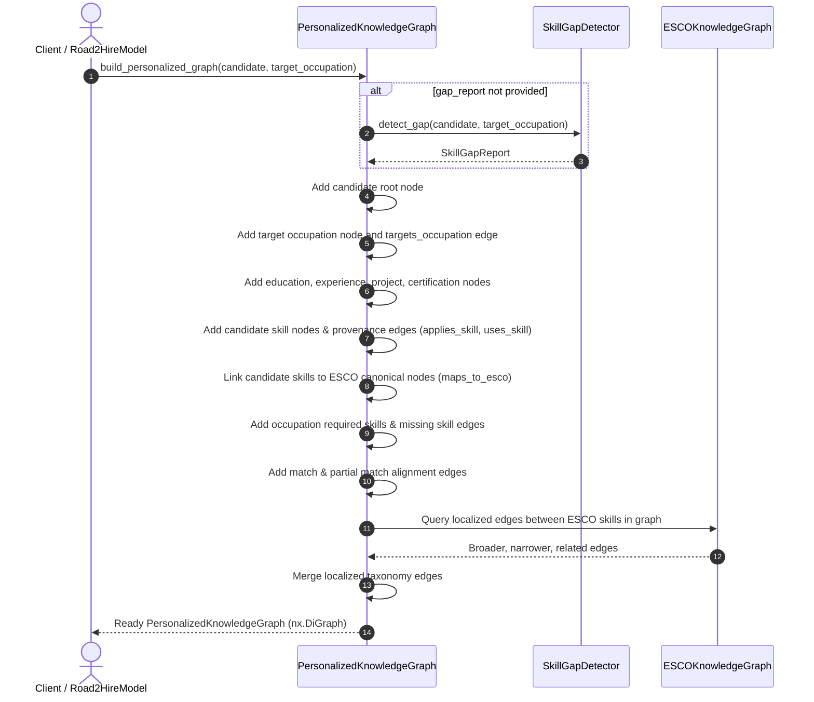

# Road2Hire — M3: Personalized Knowledge Graph Construction

## 1. Executive Summary & Objective

The **Personalized Knowledge Graph** represents a candidate's career readiness state by linking their validated resume entities with the European Skills, Competences, Qualifications and Occupations (**ESCO**) taxonomy and the output of the **M3 Hybrid Skill Gap Detection** engine.

Rather than duplicating the global 17,618-node, 158,509-edge ESCO Knowledge Graph for each candidate, the personalized graph constructs a targeted, contextual directed graph (`nx.DiGraph`) containing:
1. **Candidate Profile Entities**: Root candidate profile, education history, work/internship experience, projects, certifications, and claimed skills.
2. **Provenance & Evidence Links**: Edges connecting where skills were used, developed, or certified in the candidate's history (`applies_skill`, `uses_skill`, `certifies_skill`).
3. **ESCO Taxonomy Grounding**: Canonical ESCO nodes for mapped skills and the target occupation, preserving official URIs.
4. **Skill Gap Alignment**: Distinct, explainable representations of matched skills (exact/semantic), partially matched skills (taxonomic/semantic), missing essential/optional requirements, and surplus skills.
5. **Taxonomic Hierarchy & Semantic Preservation**: Preserving localized `broader_skill`, `narrower_skill`, and `related` relationships between the relevant ESCO skills.

---

## 2. Architecture & Design Principles



### Core Design Rules:
1. **Zero Global Graph Duplication**: The global 17,618-node ESCO graph is never copied. The personalized graph contains only the candidate's components, the selected occupation, its required skills, and the active candidate skills.
2. **Deterministic Canonical Identifiers**:
   - Candidate components: `candidate:root`, `candidate:education:{idx}`, `candidate:experience:{idx}`, `candidate:project:{idx}`, `candidate:certification:{idx}`, `candidate:skill:{normalized_name}`.
   - ESCO concepts: Canonical ESCO URI strings (`http://data.europa.eu/esco/occupation/...`, `http://data.europa.eu/esco/skill/...`).
3. **Collision-Free Multi-Relation Merging**: When multiple relationships exist between two directed nodes (e.g., an occupation requirement that is also a missing skill, or two ESCO skills with overlapping hierarchy/related edges), edge attributes are merged into `relations` and `relation_names` without data overwriting.
4. **Explainable Skill Provenance**: Enables downstream modules and UI widgets to answer: *"Where did the candidate learn or apply this skill?"* through `applies_skill` and `uses_skill` edges.
5. **Freshers & Incomplete Profile Tolerance**: Profiles with zero skills, zero experience, or missing sections construct valid graphs without exceptions, providing 100% missing requirement edges.

---

## 3. Node Taxonomy

| Node Kind | ID Pattern | Key Attributes | Description |
|-----------|------------|----------------|-------------|
| `candidate` | `candidate:root` | `name`, `email`, `phone`, `location`, `summary`, `schema_version` | Root candidate entity. |
| `education` | `candidate:education:{idx}` | `degree`, `field_of_study`, `institution`, `start_year`, `end_year`, `grade`, `academic_level` | Academic record. |
| `experience` | `candidate:experience:{idx}` | `job_title`, `organization`, `employment_type`, `start_date`, `end_date`, `responsibilities`, `skills_used` | Work/internship history. |
| `project` | `candidate:project:{idx}` | `project_name`, `description`, `technologies`, `related_skills` | Technical project. |
| `certification` | `candidate:certification:{idx}` | `name`, `issuing_organization`, `issue_date`, `expiration_date`, `credential_id` | Certified credential. |
| `candidate_skill` | `candidate:skill:{norm_name}` | `name`, `label`, `esco_uri`, `is_esco_mapped`, `gap_status` | Candidate claimed skill. |
| `esco_skill` | `http://data.europa.eu/esco/skill/{uuid}` | `label`, `uri`, `skill_type`, `requirement_type`, `gap_status` | Canonical ESCO taxonomy skill. |
| `occupation` | `http://data.europa.eu/esco/occupation/{uuid}` | `label`, `uri`, `description`, `essential_skills_count`, `optional_skills_count` | Target career occupation. |

---

## 4. Edge Taxonomy

| Edge Relation | Source Node | Target Node | Category | Description |
|---------------|-------------|-------------|----------|-------------|
| `has_education` | `candidate:root` | `candidate:education:{idx}` | Profile Component | Links candidate to education. |
| `has_experience` | `candidate:root` | `candidate:experience:{idx}` | Profile Component | Links candidate to work experience. |
| `has_project` | `candidate:root` | `candidate:project:{idx}` | Profile Component | Links candidate to project. |
| `has_certification` | `candidate:root` | `candidate:certification:{idx}` | Profile Component | Links candidate to credential. |
| `has_skill` | `candidate:root` | `candidate:skill:{name}` | Possession | Candidate possesses claimed skill. |
| `has_surplus_skill` | `candidate:root` | `candidate:skill:{name}` | Skill Gap | Skill not required by occupation. |
| `targets_occupation` | `candidate:root` | ESCO Occupation URI | Career Goal | Links candidate to target goal with coverage scores. |
| `applies_skill` | `candidate:experience:{idx}` | `candidate:skill:{name}` | Provenance | Skill applied in work experience. |
| `uses_skill` | `candidate:project:{idx}` | `candidate:skill:{name}` | Provenance | Skill or technology used in project. |
| `maps_to_esco` | `candidate:skill:{name}` | ESCO Skill URI | Taxonomy Grounding | Normalizes candidate skill to ESCO concept. |
| `requires_essential_skill` | ESCO Occupation URI | ESCO Skill URI | Requirement | Occupation essential requirement. |
| `requires_optional_skill` | ESCO Occupation URI | ESCO Skill URI | Requirement | Occupation optional recommendation. |
| `has_missing_skill` | ESCO Occupation URI | ESCO Skill URI | Skill Gap | Required skill not held by candidate. |
| `matches_skill` | `candidate:skill:{name}` | ESCO Skill URI | Skill Gap Alignment | Confirmed exact or high semantic match (credit 1.0). |
| `partially_matches_skill` | `candidate:skill:{name}` | ESCO Skill URI | Skill Gap Alignment | Partial match via taxonomy hierarchy or related semantics. |
| `broader_skill` | ESCO Skill URI | ESCO Skill URI | ESCO Taxonomy | Candidate/target skill is broader concept. |
| `narrower_skill` | ESCO Skill URI | ESCO Skill URI | ESCO Taxonomy | Candidate/target skill is narrower concept. |
| `related` | ESCO Skill URI | ESCO Skill URI | ESCO Taxonomy | Associative semantic link between ESCO skills. |

---

## 5. Construction Workflow



---

## 6. Python Usage Example

### Via Central `Road2HireModel` Interface
```python
from AI.road2hire_model import Road2HireModel

model = Road2HireModel()

# Build personalized knowledge graph directly from a PDF resume or candidate profile
pkg = model.build_personalized_graph(
    resume_or_profile="Tests/AI/sample_resume.pdf",
    target_occupation="software developer",
)

# Inspect high-level metrics
summary = pkg.get_summary()
print(f"Total Nodes: {summary['total_nodes']}")
print(f"Total Edges: {summary['total_edges']}")
print(f"Overall Coverage: {summary['overall_skill_coverage_score']:.2%}")

# Query missing skills
missing_skills = pkg.get_missing_skills()
print(f"Missing Required Skills: {len(missing_skills)}")

# Query matched skills
matched_skills = pkg.get_matched_skills()
for m in matched_skills[:3]:
    print(f"Matched: {m['candidate_skill']} -> {m['target_skill']} ({m['tier']})")

# Export to JSON-serializable dictionary for API/frontend visualization
graph_data = pkg.to_dict()
```

---

## 7. Sample Serialized Output Structure (`to_dict()`)

```json
{
  "summary": {
    "total_nodes": 48,
    "total_edges": 72,
    "node_counts_by_kind": {
      "candidate": 1,
      "education": 1,
      "experience": 1,
      "project": 1,
      "certification": 1,
      "candidate_skill": 6,
      "esco_skill": 36,
      "occupation": 1
    },
    "edge_counts_by_relation": {
      "targets_occupation": 1,
      "has_education": 1,
      "has_experience": 1,
      "has_project": 1,
      "has_certification": 1,
      "has_skill": 6,
      "applies_skill": 2,
      "uses_skill": 2,
      "maps_to_esco": 5,
      "requires_essential_skill": 22,
      "requires_optional_skill": 14,
      "has_missing_skill": 32,
      "matches_skill": 4,
      "partially_matches_skill": 0,
      "has_surplus_skill": 2
    },
    "overall_skill_coverage_score": 0.1818,
    "essential_skill_coverage_score": 0.1818,
    "optional_skill_coverage_score": 0.0
  },
  "nodes": [
    {
      "id": "candidate:root",
      "kind": "candidate",
      "name": "Jane Doe",
      "email": "jane.doe@example.com",
      "schema_version": "1.1.0"
    },
    {
      "id": "candidate:skill:python (computer programming)",
      "kind": "candidate_skill",
      "name": "Python (computer programming)",
      "is_esco_mapped": true,
      "gap_status": "matched"
    },
    {
      "id": "http://data.europa.eu/esco/skill/4c5b2a62-5a76-4d99-a7a8-cbf04e9e8d1e",
      "kind": "esco_skill",
      "label": "Python (computer programming)",
      "requirement_type": "essential",
      "gap_status": "matched"
    }
  ],
  "edges": [
    {
      "source": "candidate:root",
      "target": "http://data.europa.eu/esco/occupation/52922112-9c16-4318-8fb3-a9d554a93883",
      "relation": "targets_occupation",
      "relation_type": "career_goal",
      "overall_coverage_score": 0.1818
    },
    {
      "source": "candidate:skill:python (computer programming)",
      "target": "http://data.europa.eu/esco/skill/4c5b2a62-5a76-4d99-a7a8-cbf04e9e8d1e",
      "relation": "matches_skill",
      "relation_type": "skill_gap_alignment",
      "tier": "exact",
      "credit_assigned": 1.0
    }
  ]
}
```

